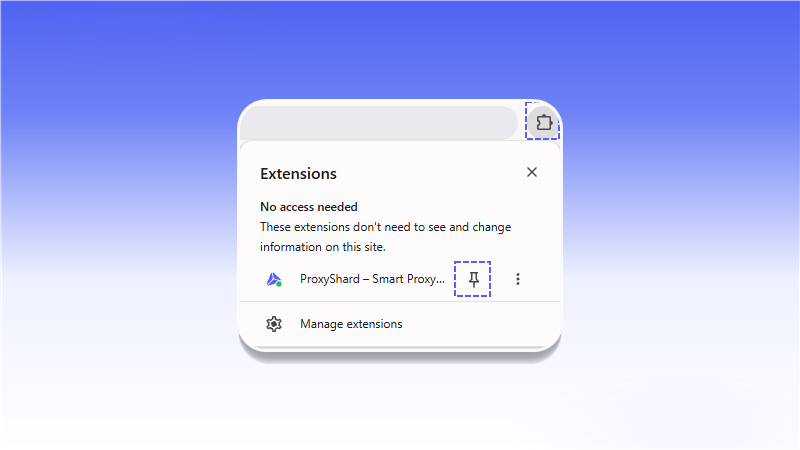
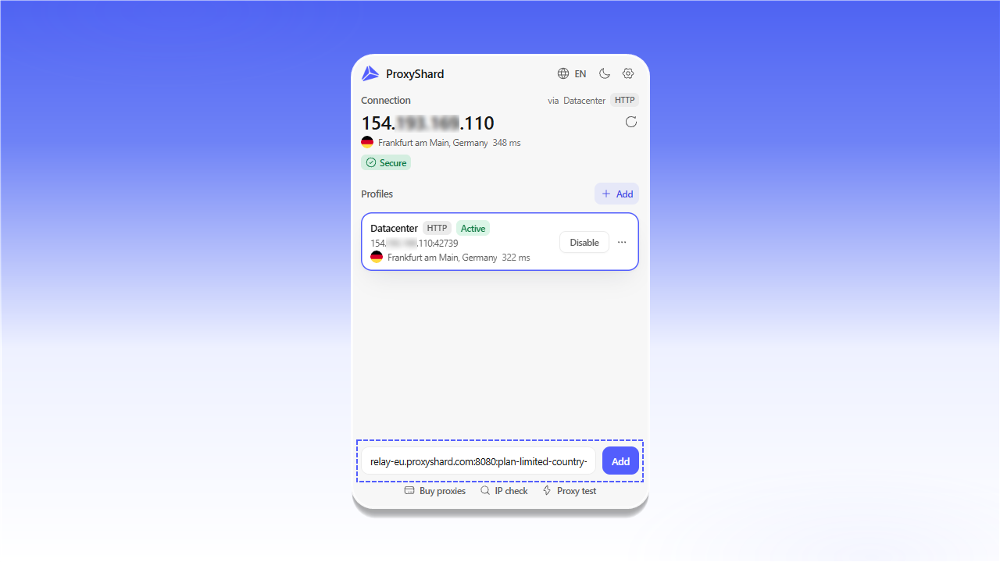
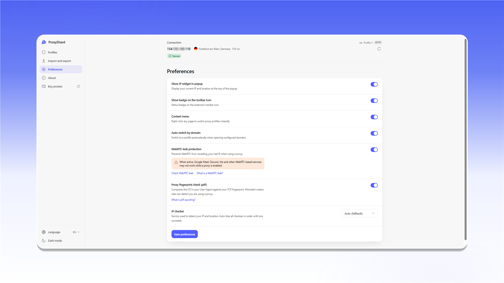

# ShardX Extension

<mark style="color:purple;">**ShardX – Smart Proxy Manager**</mark> is the official ShardX extension for Chrome, Mozilla Firefox, and Chromium-based browsers such as Edge, Opera, Brave, and Yandex. It lets you add, test, and switch proxies directly in your browser.

#### Extension features

* Unlimited proxy profiles
* HTTP / HTTPS support in every supported browser
* SOCKS5 support in Mozilla Firefox
* Connection, IP address, country, and latency checks
* Mobile proxy IP rotation by interval or keyboard shortcut
* Domain routing rules and automatic profile switching
* WebRTC leak protection and TCP fingerprint checks with p0f
* Profile import and export
* English, Russian, Ukrainian, and Chinese interface languages

<figure>
  <picture>
    <source srcset="../.gitbook/assets/proxyshard-extension-popup-overview_black.png" media="(prefers-color-scheme: dark)">
    
  </picture>
  <figcaption>
The main window with saved proxy profiles
</figcaption>
</figure>

## Install the extension

The extension is available from the official Chrome Web Store and Firefox Add-ons. The Chrome Web Store version also works in Edge, Opera, Brave, and other Chromium-based browsers.

### Chrome, Edge, Opera, Brave, Yandex, and other Chromium-based browsers



### Mozilla Firefox



After installation, open the `Extensions` menu to the right of the address bar and pin `ShardX – Smart Proxy Manager` by clicking the pin icon.

<figure>
  <picture>
    <source srcset="../.gitbook/assets/proxyshard-extension-pin_black.png" media="(prefers-color-scheme: dark)">
    
  </picture>
  <figcaption>
Open the Extensions menu and pin the extension
</figcaption>
</figure>


**SOCKS5 limitation in Chromium-based browsers**

Chrome and other Chromium-based browsers do not support username and password authentication for SOCKS5 proxies through Manifest V3 extensions.

You can use SOCKS5 only without credentials or with IP allowlist authentication. Select HTTP / HTTPS for proxies that require a username and password.



**SOCKS5 in Mozilla Firefox**

The Mozilla Firefox version of ShardX Extension supports authenticated SOCKS5, so you can use these profiles directly.


## Set up a Residential proxy

1. Open your order on the [Residential proxy](https://dashboard.shardx.com/en/residential-main) page.
2. Select the country, region, session type, protocol, and other settings, then click `Generate proxy`.
3. Select the required format in `Proxy List`, then click `Copy all`.

<figure>
  <picture>
    <source srcset="../.gitbook/assets/proxyshard-extension-residential-generate_black.png" media="(prefers-color-scheme: dark)">
    
  </picture>
  <figcaption>
Residential proxy settings and the Proxy List section
</figcaption>
</figure>

4. Open the pinned ShardX extension.
5. Paste the proxy string in `ip:port:login:password` format into the field at the bottom, then click `Add`.

<figure>
  <picture>
    <source srcset="../.gitbook/assets/proxyshard-extension-add-proxy-string_black.png" media="(prefers-color-scheme: dark)">
    
  </picture>
  <figcaption>
Paste the connection string and click Add
</figcaption>
</figure>

6. The new profile appears in the list. Open its `...` menu, select `Test connection`, and click `Enable` after the test succeeds.

<figure>
  <picture>
    <source srcset="../.gitbook/assets/proxyshard-extension-profile-actions_black.png" media="(prefers-color-scheme: dark)">
    
  </picture>
  <figcaption>
Profile test, edit, and delete actions
</figcaption>
</figure>

## Set up a Datacenter or ISP proxy

1. Open the Datacenter or ISP proxy order in your dashboard.
2. Select the protocol and format in `Proxy List`, then click `Copy all`.

<figure>
  <picture>
    <source srcset="../.gitbook/assets/proxyshard-extension-datacenter-proxy-list_black.png" media="(prefers-color-scheme: dark)">
    
  </picture>
  <figcaption>
Copy the connection string from Proxy List
</figcaption>
</figure>

3. Open the extension, paste the string into the field at the bottom, and click `Add`.

<figure>
  <picture>
    <source srcset="../.gitbook/assets/proxyshard-extension-add-datacenter-proxy_black.png" media="(prefers-color-scheme: dark)">
    
  </picture>
  <figcaption>
Add a Datacenter or ISP proxy
</figcaption>
</figure>

4. Open the new profile's `...` menu and select `Test connection`.
5. If the test succeeds, click `Enable`. Enabling another profile automatically switches the current connection.

<figure>
  <picture>
    <source srcset="../.gitbook/assets/proxyshard-extension-profile-switch_black.png" media="(prefers-color-scheme: dark)">
    
  </picture>
  <figcaption>
Test and enable the new profile
</figcaption>
</figure>

## Mobile proxy IP rotation

Open the profile's `...` menu, click `Edit`, and expand `IP rotation`.

* `Enable IP rotation` turns on automatic IP rotation.
* Paste the IP rotation link from your mobile proxy order into `Rotation URL`.
* Under `Trigger`, select `Hotkey` or `Interval`.
* For `Hotkey`, enter a keyboard shortcut such as `Shift+F2`. To use it on internal `chrome://` pages, assign it separately at `chrome://extensions/shortcuts`.
* For `Interval`, set the time between IP rotation requests.
* `Track IP history (detects duplicate IPs)` detects when the same IP address is assigned again.

Click `Save profile` to save the settings.

<figure>
  <picture>
    <source srcset="../.gitbook/assets/proxyshard-extension-edit-profile-ip-rotation_black.png" media="(prefers-color-scheme: dark)">
    
  </picture>
  <figcaption>
Rotate the IP by keyboard shortcut or interval
</figcaption>
</figure>

## Domain routing and automatic switching

The profile editor includes `Domain routing` and `Auto-switch` sections.

### Domain routing

This section controls how proxy traffic is routed for specific domains.

* `Enable routing rules` turns on domain routing rules.
* `Whitelist` sends only the specified domains through the proxy.
* `Blacklist` excludes the specified domains from proxy routing.
* Under `Domains`, enter one domain per line. To include subdomains, add the `*.` wildcard before the domain, for example `*.google.com`.

### Auto-switch

This feature automatically enables the selected profile when you open configured websites.

* `Enable auto-switch` turns on automatic profile switching.
* Under `Activate on these domains`, enter one domain per line, for example `example.com` or `*.work-site.com`.

Click `Save profile` to save the changes or `Cancel` to close the window without saving.

<figure>
  <picture>
    <source srcset="../.gitbook/assets/proxyshard-extension-edit-profile-routing_black.png" media="(prefers-color-scheme: dark)">
    
  </picture>
  <figcaption>
Domain routing and automatic profile switching
</figcaption>
</figure>

## Add a profile manually

1. Click the gear icon in the main extension window and open `Profiles`.
2. Click `+ Add profile`, then select the `Manual` tab.
3. Complete the fields:
   * `Name` - profile name;
   * `Type` - connection type;
   * `Host` and `Port` - proxy server address and port;
   * `Bypass list` - addresses that should connect directly, one per line;
   * `Username` and `Password` - authentication credentials.
4. If required, configure `IP rotation`, `Domain routing`, and `Auto-switch domains`.
5. Click `Save profile`.

To add a complete proxy string quickly, use the `Quick paste` tab.

<figure>
  <picture>
    <source srcset="../.gitbook/assets/proxyshard-extension-options-add-profile_black.png" media="(prefers-color-scheme: dark)">
    
  </picture>
  <figcaption>
The Add profile form on the Manual tab
</figcaption>
</figure>

## Import and export profiles

The `Import and export` section lets you back up your profiles and restore them when needed.

* `Export profiles` saves every profile to a JSON file. Click `Export JSON` and store the file in a secure location.
* `Import from JSON` restores profiles from a previously exported file. Click `Import JSON` and select the backup.


The backup may contain proxy addresses and authentication credentials. Do not share it with anyone you do not trust.


<figure>
  <picture>
    <source srcset="../.gitbook/assets/proxyshard-extension-options-import-export_black.png" media="(prefers-color-scheme: dark)">
    
  </picture>
  <figcaption>
Back up and restore proxy profiles
</figcaption>
</figure>

## Preferences

The `Preferences` section contains the following settings:

* `Show IP widget in popup` displays your current IP address and location at the top of the extension popup.
* `Show badge on the toolbar icon` displays a connection status indicator on the extension icon.
* `Context menu` adds profile switching to the browser's right-click menu.
* `Auto-switch by domain` allows profiles to activate automatically for configured domains.
* `WebRTC leak protection` helps prevent your real IP address from being exposed through WebRTC. Some WebRTC-based services may not work correctly while it is enabled. Learn more in [UDP and WebRTC](about-udp/README.md).
* `Proxy fingerprint check (p0f)` compares the operating system in the User-Agent with the TCP fingerprint. A mismatch may indicate proxy use. Learn more in [OS fingerprint spoofing with p0f](p0f-spoofing.md).
* `IP checker` lets you select the service used to detect your IP address and location. In `Auto (fallback)` mode, the extension tries the available services in sequence until one responds.

Click `Save preferences` after changing the settings.

<figure>
  <picture>
    <source srcset="../.gitbook/assets/proxyshard-extension-options-preferences_black.png" media="(prefers-color-scheme: dark)">
    
  </picture>
  <figcaption>
Additional extension settings
</figcaption>
</figure>


ShardX Extension is ready to use. You can enable and switch saved profiles from the main extension window.

