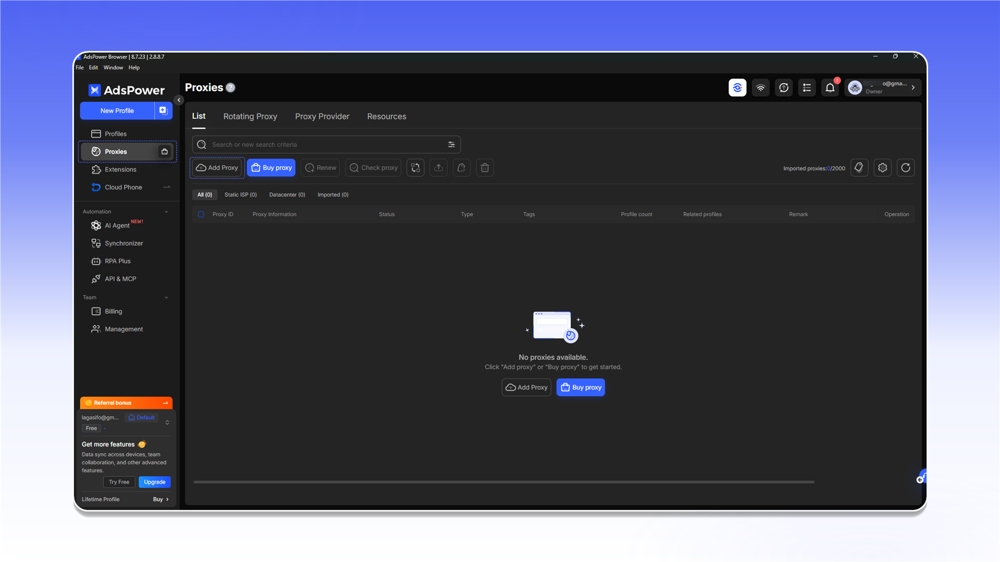
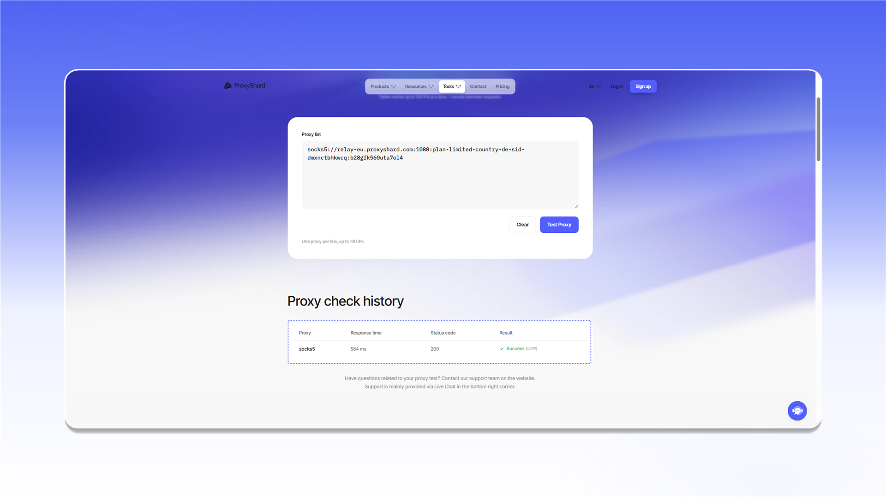

# AdsPower


AdsPower does not support UDP proxies. Use [Vision Browser](vision-browser.md) when UDP is required.


## Add a proxy

Open `Proxies` and click `Add Proxy`.

<figure>
  <picture>
    <source srcset="../../.gitbook/assets/adspower-proxies-add-proxy_black.png" media="(prefers-color-scheme: dark)">
    
  </picture>
</figure>

1. Copy the connection string from the relevant order's `Proxy List` and paste it into the form.
2. Click `Check proxy`.
3. After a successful check, click `OK`.

<figure>
  <picture>
    <source srcset="../../.gitbook/assets/adspower-add-proxy-form_black.png" media="(prefers-color-scheme: dark)">
    
  </picture>
</figure>


See the [general setup guide](../getting-started.md) for help finding the connection details.


If the check fails, verify the username, password, and protocol. You can also test the connection with [Proxy Tester](../../our-products/proxy-tester.md).

<figure>
  <picture>
    <source srcset="../../.gitbook/assets/adspower-proxy-tester-result_black.png" media="(prefers-color-scheme: dark)">
    
  </picture>
</figure>

## Assign the proxy to a profile

Open `Profiles` and click `New Profile`.

<figure>
  <picture>
    <source srcset="../../.gitbook/assets/adspower-profiles-new-profile_black.png" media="(prefers-color-scheme: dark)">
    
  </picture>
</figure>

In the profile settings, select the added server under `Saved Proxies`, test it, and save the profile.

<figure>
  <picture>
    <source srcset="../../.gitbook/assets/adspower-new-profile-saved-proxy_black.png" media="(prefers-color-scheme: dark)">
    
  </picture>
</figure>
