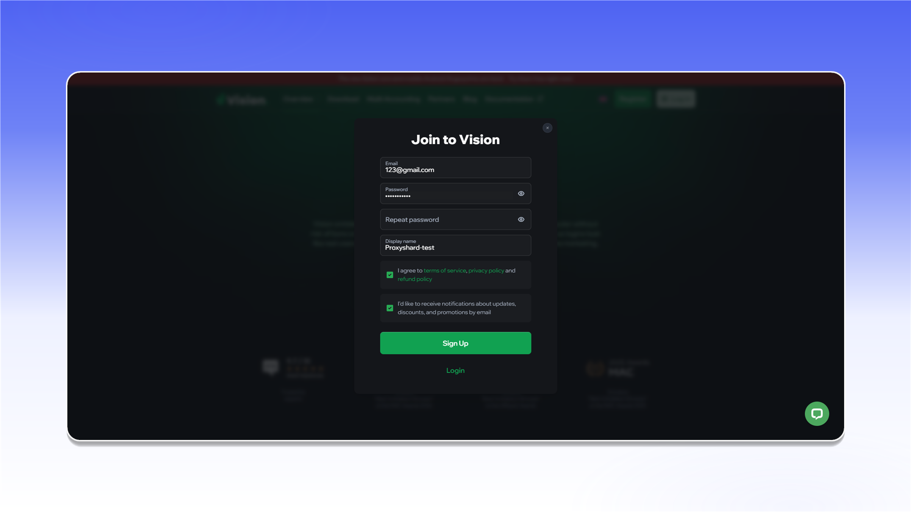
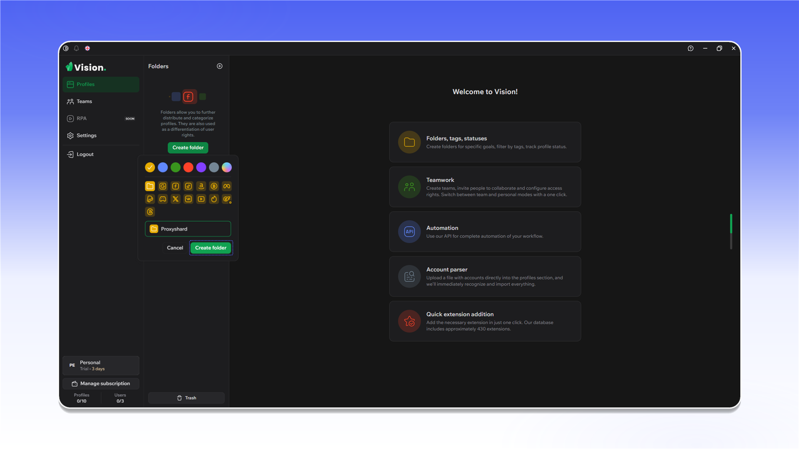
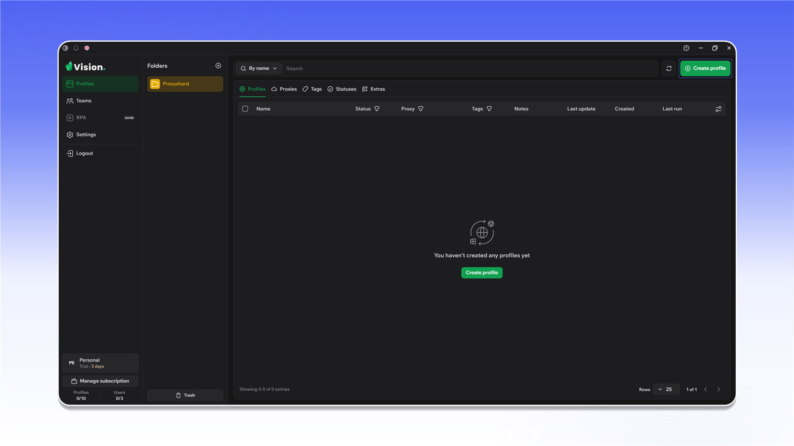

# Vision Browser


Vision Browser supports TCP and UDP traffic through SOCKS5 proxies.


## Installation and registration

Open the [Vision Browser website](https://browser.vision/r/ecf2408f-02de-4e4f-bc24-be368ac32325), download the application, and install it.

<figure>
  <picture>
    <source srcset="../../.gitbook/assets/vision-website-download_black.png" media="(prefers-color-scheme: dark)">
    
  </picture>
</figure>

Create an account. You will use these credentials to sign in to the application.

<figure>
  <picture>
    <source srcset="../../.gitbook/assets/vision-sign-up_black.png" media="(prefers-color-scheme: dark)">
    
  </picture>
</figure>

When purchasing a plan, you can use the `PROXYSHARD` promo code for a 20% discount.

<figure>
  <picture>
    <source srcset="../../.gitbook/assets/vision-plan-promo-code_black.png" media="(prefers-color-scheme: dark)">
    
  </picture>
</figure>

## Create the first profile

1. Open `Profiles`.
2. Go to `Folders` and click `Create folder`.

<figure>
  <picture>
    <source srcset="../../.gitbook/assets/vision-folders-create_black.png" media="(prefers-color-scheme: dark)">
    
  </picture>
</figure>

Enter a folder name and save it.

<figure>
  <picture>
    <source srcset="../../.gitbook/assets/vision-folder-create-form_black.png" media="(prefers-color-scheme: dark)">
    
  </picture>
</figure>

Click `Create profile` inside the folder.

<figure>
  <picture>
    <source srcset="../../.gitbook/assets/vision-profiles-create-profile_black.png" media="(prefers-color-scheme: dark)">
    
  </picture>
</figure>

Generate one SOCKS5 proxy in the ShardX dashboard and copy its connection details.

<figure>
  <picture>
    <source srcset="../../.gitbook/assets/vision-residential-generate-single_black.png" media="(prefers-color-scheme: dark)">
    
  </picture>
</figure>

In the Vision profile settings, open the `SOCKS` tab, enter the proxy details, test the connection, and click `Save`.

<figure>
  <picture>
    <source srcset="../../.gitbook/assets/vision-create-profile-socks_black.png" media="(prefers-color-scheme: dark)">
    
  </picture>
</figure>

<figure><figcaption></figcaption></figure>

## Add a proxy list

Open the `Proxies` tab and click `Add proxy`.

<figure>
  <picture>
    <source srcset="../../.gitbook/assets/vision-proxies-add-proxy_black.png" media="(prefers-color-scheme: dark)">
    
  </picture>
</figure>

Generate a SOCKS5 proxy list in the ShardX dashboard and copy it.

<figure>
  <picture>
    <source srcset="../../.gitbook/assets/vision-residential-generate-list_black.png" media="(prefers-color-scheme: dark)">
    
  </picture>
</figure>

Paste the list into the add field. After import, confirm that the connections show `Online`.

<figure>
  <picture>
    <source srcset="../../.gitbook/assets/vision-proxies-imported-list_black.png" media="(prefers-color-scheme: dark)">
    
  </picture>
</figure>

To assign a proxy to an existing profile, click the icon in the `Proxy` column.

<figure><figcaption></figcaption></figure>

Choose `Select proxy`, select the required connection, and test it.

<figure><figcaption></figcaption></figure>

After saving, the assigned proxy appears in the profile row.

<figure><figcaption></figcaption></figure>

## Check WebRTC

Start the profile and open [ShardX IP Checker](https://proxyshard.com/ip-checker). The TCP and WebRTC addresses should match.

<figure>
  <picture>
    <source srcset="../../.gitbook/assets/vision-webrtc-check_black.png" media="(prefers-color-scheme: dark)">
    
  </picture>
</figure>
