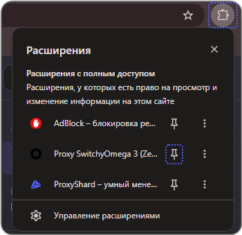
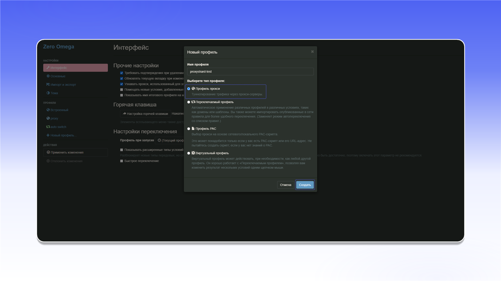

# ZeroOmega

## Installing ZeroOmega


ZeroOmega handles TCP traffic only. Use [Vision Browser](../../antidetect-browsers/vision-browser.md) when you need UDP support.


Install [ZeroOmega](https://chromewebstore.google.com/detail/pfnededegaaopdmhkdmcofjmoldfiped) from the Chrome Web Store.



After installation, open the extensions menu and pin ZeroOmega to the browser toolbar.

<figure><figcaption></figcaption></figure>

Open ZeroOmega and select `Параметры`.

<figure>
  <picture>
    <source srcset="../../../.gitbook/assets/chrome-zeroomega-open-options_black.png" media="(prefers-color-scheme: dark)">
    
  </picture>
</figure>

## Configuring the proxy

In the profiles section, click `Новый профиль...`.

<figure>
  <picture>
    <source srcset="../../../.gitbook/assets/chrome-zeroomega-new-profile_black.png" media="(prefers-color-scheme: dark)">
    
  </picture>
</figure>

Enter a profile name, select `Профиль прокси`, and click `Создать`.

<figure>
  <picture>
    <source srcset="../../../.gitbook/assets/chrome-zeroomega-new-profile-dialog_black.png" media="(prefers-color-scheme: dark)">
    
  </picture>
</figure>

In the profile settings, select the protocol and enter the server address and port from your order's `Proxy List`. Click the lock icon to add the username and password.


The data format and an example order are described in [Getting Started](../../getting-started.md).


<figure>
  <picture>
    <source srcset="../../../.gitbook/assets/chrome-zeroomega-proxy-server_black.png" media="(prefers-color-scheme: dark)">
    
  </picture>
</figure>

Enter the proxy username and password, then click `Сохранить изменения`.

<figure>
  <picture>
    <source srcset="../../../.gitbook/assets/chrome-zeroomega-proxy-auth_black.png" media="(prefers-color-scheme: dark)">
    
  </picture>
</figure>

Click `Применить изменения` to save the profile.

<figure>
  <picture>
    <source srcset="../../../.gitbook/assets/chrome-zeroomega-apply-changes_black.png" media="(prefers-color-scheme: dark)">
    
  </picture>
</figure>

Open ZeroOmega from the browser toolbar and select the profile you created.

<figure><figcaption></figcaption></figure>

The proxy is connected and ready to use in Chrome.
