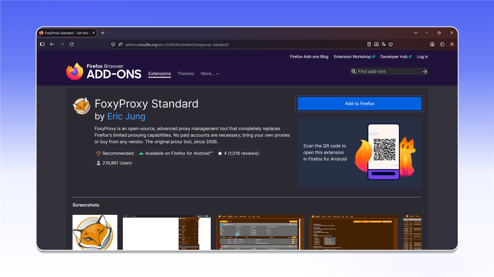

# FoxyProxy

## Installing FoxyProxy


FoxyProxy handles TCP traffic only.


Install [FoxyProxy Standard](https://addons.mozilla.org/firefox/addon/foxyproxy-standard/) from Firefox Add-ons.



<figure>
  <picture>
    <source srcset="../../../.gitbook/assets/foxyproxy-addon-page_black.png" media="(prefers-color-scheme: dark)">
    
  </picture>
</figure>

After installation, open FoxyProxy and go to the extension settings.

<figure>
  <picture>
    <source srcset="../../../.gitbook/assets/foxyproxy-options-popup-disable_black.png" media="(prefers-color-scheme: dark)">
    
  </picture>
</figure>

## Configuring the proxy

Open `Proxies` and click `Add`.

<figure>
  <picture>
    <source srcset="../../../.gitbook/assets/foxyproxy-add-proxy-form_black.png" media="(prefers-color-scheme: dark)">
    
  </picture>
</figure>


The data format and an example order are described in [Getting Started](../../getting-started.md).


Enter a profile name in `Title`. Select the proxy type, then fill in `Hostname`, `Port`, `Username`, and `Password` using the details from your order's `Proxy List`. Click `Save`.

<figure>
  <picture>
    <source srcset="../../../.gitbook/assets/foxyproxy-proxy-config-filled_black.png" media="(prefers-color-scheme: dark)">
    
  </picture>
</figure>

## Connecting

Open FoxyProxy and select the profile you created.

<figure>
  <picture>
    <source srcset="../../../.gitbook/assets/foxyproxy-options-popup-proxyshard_black.png" media="(prefers-color-scheme: dark)">
    
  </picture>
</figure>

The proxy is connected and ready to use in Mozilla Firefox.
