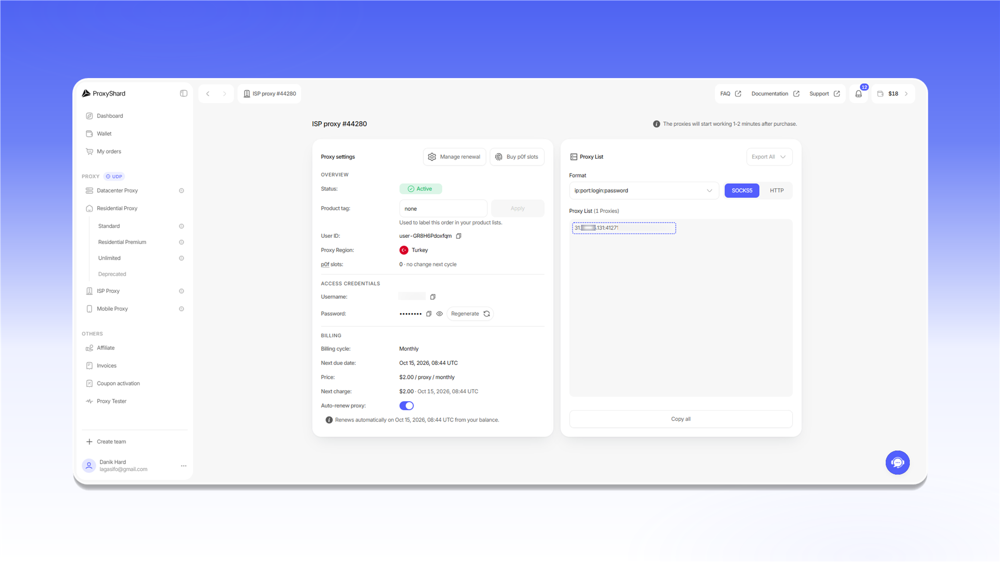

# Setup guide

Before configuring an application, open the required [order](https://dashboard.proxyshard.com/products) and copy its connection details.


The examples below use `SOCKS5`. If an application supports only HTTP, select `HTTP` in the order settings and use the corresponding port.


## Residential proxies

1. In `Proxy settings`, select a country and configure `Session`, `Relay`, and `Protocol`.
2. Click `Generate proxy`.
3. Copy the generated connection string from `Proxy List`.

<figure>
  <picture>
    <source srcset="../.gitbook/assets/residential-proxy-setup_black.png" media="(prefers-color-scheme: dark)">
    
  </picture>
</figure>

## Datacenter and ISP proxies

Open the order and copy the connection string from `Proxy List`.

<figure>
  <picture>
    <source srcset="../.gitbook/assets/static-proxy-setup_black.png" media="(prefers-color-scheme: dark)">
    
  </picture>
</figure>

## Connection string format

The standard format is `server:port:login:password`.

<figure>
  <picture>
    <source srcset="../.gitbook/assets/proxy-format-breakdown_black.png" media="(prefers-color-scheme: dark)">
    
  </picture>
</figure>

| Field | Description |
|---|---|
| `Server / Host` | The proxy server IP address or hostname |
| `Port` | The connection port |
| `Login` | The username. For residential proxies, it may also contain targeting parameters |
| `Password` | The access password |

If the application does not accept a complete connection string, enter these values in separate fields.

## Selecting a protocol

For datacenter and ISP proxies, switch the format in `Proxy List`.

<figure>
  <picture>
    <source srcset="../.gitbook/assets/proxy-protocol-toggle_black.png" media="(prefers-color-scheme: dark)">
    
  </picture>
</figure>

For residential proxies, select the protocol in the `Protocol` field before generating the connection string.

<figure>
  <picture>
    <source srcset="../.gitbook/assets/proxy-protocol-select_black.png" media="(prefers-color-scheme: dark)">
    
  </picture>
</figure>

Mobile proxies accept HTTP and SOCKS5 connections on the assigned port. No additional format switch is required in the order.
