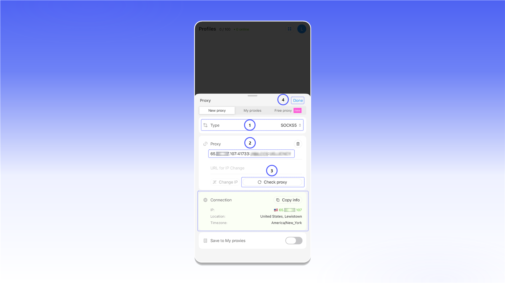

# Octo Browser for iOS and Android


The proxy applies only to the active Octo Browser profile. Other apps on the device continue using their regular Internet connection.


## Install Octo Browser

Download Octo Browser from the App Store or Google Play.





## Create an account and sign in

Create an account with your email address or tap **Sign up with Apple**.

<figure>
  <picture>
    <source srcset="../../.gitbook/assets/octo-browser-ios-log-in_black.png" media="(prefers-color-scheme: dark)">
    
  </picture>
</figure>

After registration, sign in using the same method.

## Create a profile with a proxy

On the **Profiles** screen, tap **Create Profile**.

<figure>
  <picture>
    <source srcset="../../.gitbook/assets/octo-browser-ios-create-profile_black.png" media="(prefers-color-scheme: dark)">
    
  </picture>
</figure>

In the new profile settings, tap **Set a proxy**.

<figure>
  <picture>
    <source srcset="../../.gitbook/assets/octo-browser-ios-set-proxy_black.png" media="(prefers-color-scheme: dark)">
    
  </picture>
</figure>

1. Under **Type**, select HTTP, HTTPS, or SOCKS5.
2. Copy the complete connection string from the required ShardX order and paste it into **Proxy**.
3. Tap **Check proxy**. After a successful check, the app displays the connection IP address, location, and time zone.
4. Tap **Done**.

<figure>
  <picture>
    <source srcset="../../.gitbook/assets/octo-browser-ios-proxy-form_black.png" media="(prefers-color-scheme: dark)">
    
  </picture>
</figure>

## Start the profile

Tap **Create & Start** to save and immediately launch the profile.

<figure>
  <picture>
    <source srcset="../../.gitbook/assets/octo-browser-ios-profile-ready_black.png" media="(prefers-color-scheme: dark)">
    
  </picture>
</figure>

The profile is ready. Its traffic will now be routed through the added proxy.
