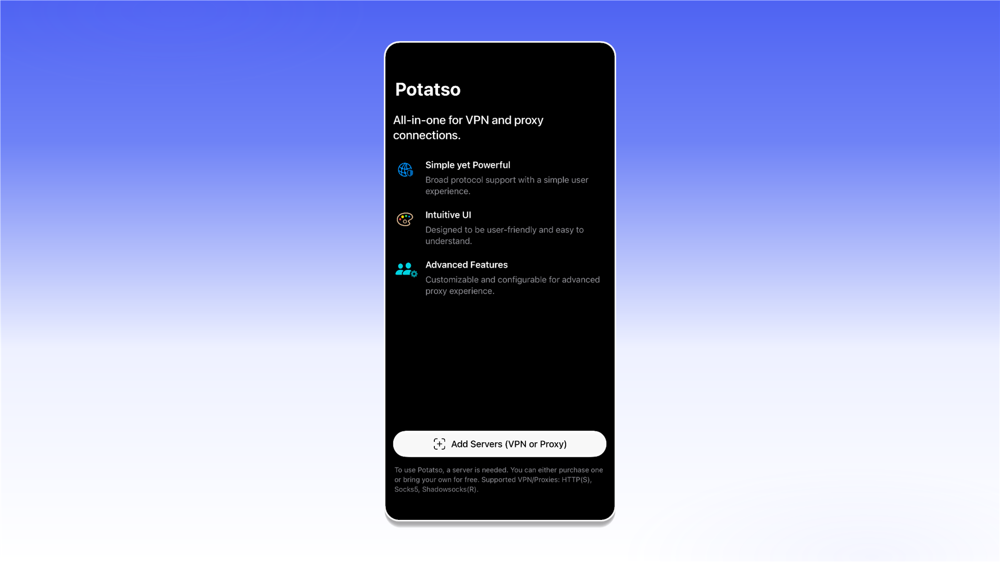
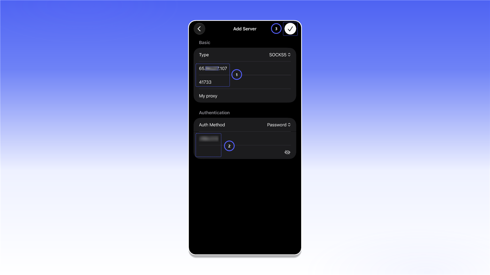

# Potatso

## Installing Potatso

Install Potatso from the App Store.



## Configuring Potatso

Open the app and tap `Add Servers`.

<figure>
  <picture>
    <source srcset="../../.gitbook/assets/potatso-ios-add-servers_black.png" media="(prefers-color-scheme: dark)">
    
  </picture>
</figure>

Select `Manual Input`.

<figure>
  <picture>
    <source srcset="../../.gitbook/assets/potatso-ios-manual-input_black.png" media="(prefers-color-scheme: dark)">
    
  </picture>
</figure>

## Configuring the profile

Select the connection type and use the details from your order's `Proxy List` to complete the form:

1. Enter the server address and port.
2. Enter the username and password.
3. Save the configuration.

<figure>
  <picture>
    <source srcset="../../.gitbook/assets/potatso-ios-add-server-form_black.png" media="(prefers-color-scheme: dark)">
    
  </picture>
</figure>


The data format and an example order are described in [Getting Started](../getting-started.md).


Select the configuration you created and enable the connection.

<figure>
  <picture>
    <source srcset="../../.gitbook/assets/potatso-ios-connect_black.png" media="(prefers-color-scheme: dark)">
    
  </picture>
</figure>

The proxy is connected and ready to use in Potatso.
