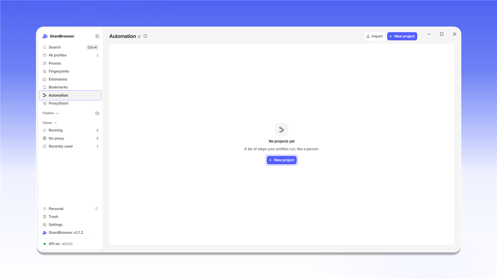

# Automation

<mark style="color:purple;">**Automation**</mark> lets you build a scenario from a sequence of actions: open a page, click an element, type text, change the proxy and so on. Click <mark style="color:purple;">**+ New project**</mark> to create a scenario. You can load a ready-made project with <mark style="color:purple;">**Import**</mark>.

<figure>
  <picture>
    <source srcset="../../.gitbook/assets/shardbrowser-automation-empty_black.png" media="(prefers-color-scheme: dark)">
    
  </picture>
  <figcaption>Automation section</figcaption>
</figure>

A scenario is built from steps in the <mark style="color:purple;">**Add a step**</mark> window. Steps are grouped into <mark style="color:purple;">**Profile**</mark>, <mark style="color:purple;">**Proxy**</mark>, <mark style="color:purple;">**Navigation**</mark>, <mark style="color:purple;">**Touch**</mark>, <mark style="color:purple;">**Pointer**</mark>, <mark style="color:purple;">**Keyboard**</mark>, <mark style="color:purple;">**Flow**</mark>, <mark style="color:purple;">**Requests**</mark>, <mark style="color:purple;">**Traffic**</mark>, <mark style="color:purple;">**Data**</mark> and <mark style="color:purple;">**Database**</mark>. You can find any step with search.

<figure>
  <picture>
    <source srcset="../../.gitbook/assets/shardbrowser-automation-add-step_black.png" media="(prefers-color-scheme: dark)">
    
  </picture>
  <figcaption>Add a step window</figcaption>
</figure>

For example, the <mark style="color:purple;">**Profile**</mark> group has these steps:

| Step                   | What it does                                  |
| ---------------------- | --------------------------------------------- |
| Temporary profile      | Creates a profile that is removed after the automation run |
| Create profile         | Creates a profile that stays                  |
| Swap proxy (live)      | Changes the proxy without restarting the browser |
| Use profile            | Uses a profile you already have               |
| Keep profile           | Keeps the temporary profile after the automation run |
| Read a profile setting | Reads a value from the profile by name        |
| Delete profile         | Deletes a profile                             |

<mark style="color:purple;">**Manage modules**</mark> manages the connected step modules.


You can also control profiles from your own code through the local HTTP API at `127.0.0.1:40325` - the <mark style="color:purple;">**API on**</mark> status is shown at the bottom of the side menu.

