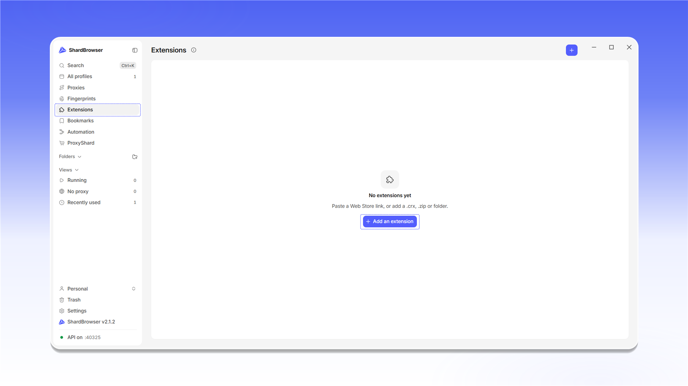
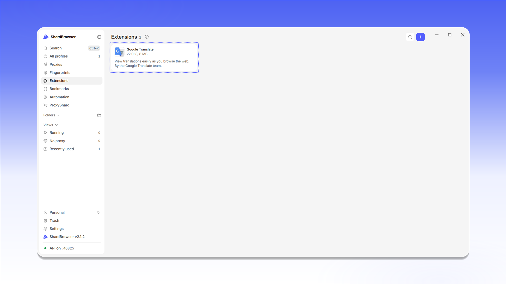

# Extensions

<mark style="color:purple;">**Extensions**</mark> stores the extensions you can attach to profiles. You add an extension once and then turn it on in the profiles that need it.

Click <mark style="color:purple;">**+ Add an extension**</mark>. You can add an extension by a Chrome Web Store link, a <mark style="color:purple;">`.crx`</mark> / <mark style="color:purple;">`.zip`</mark> file or a folder.

<figure>
  <picture>
    <source srcset="../../.gitbook/assets/shardbrowser-extensions-empty_black.png" media="(prefers-color-scheme: dark)">
    
  </picture>
  <figcaption>Extensions section</figcaption>
</figure>

In the <mark style="color:purple;">**Add from a link**</mark> window, paste the extension's Web Store page, its id or a direct link to a `.crx` / `.zip`. From a Web Store link ShardBrowser takes the id and downloads the extension by itself. Click <mark style="color:purple;">**Download**</mark>.

<figure>
  <picture>
    <source srcset="../../.gitbook/assets/shardbrowser-extension-add-link_black.png" media="(prefers-color-scheme: dark)">
    
  </picture>
  <figcaption>Paste the link and click Download</figcaption>
</figure>

The extension appears in the list with its version and size.

<figure>
  <picture>
    <source srcset="../../.gitbook/assets/shardbrowser-extensions-list_black.png" media="(prefers-color-scheme: dark)">
    
  </picture>
  <figcaption>Extension added</figcaption>
</figure>

To turn an extension on in a profile, open the profile editor (<mark style="color:purple;">**Edit**</mark>), go to the <mark style="color:purple;">**Extensions**</mark> tab, check the extensions you need and click <mark style="color:purple;">**Save**</mark>. You can also pick extensions when creating a profile, on the <mark style="color:purple;">**Extensions**</mark> tab of the <mark style="color:purple;">**New profile**</mark> window.

<figure>
  <picture>
    <source srcset="../../.gitbook/assets/shardbrowser-profile-edit-extensions_black.png" media="(prefers-color-scheme: dark)">
    
  </picture>
  <figcaption>Select the extension in the profile and click Save</figcaption>
</figure>
