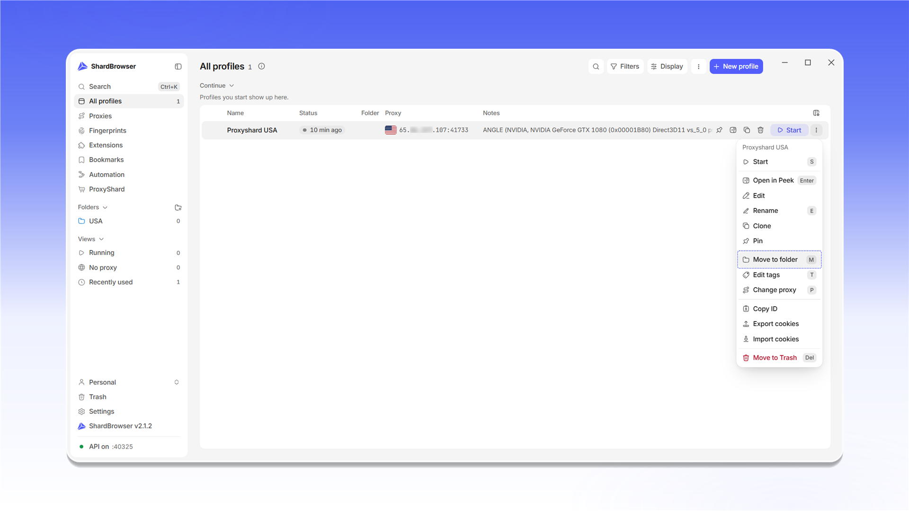

# Folders

Folders help you sort profiles by project, country or team. The folder list is in the side menu, in the <mark style="color:purple;">**Folders**</mark> block. To create a folder, click the <mark style="color:purple;">**+**</mark> icon next to <mark style="color:purple;">**Folders**</mark>.

<figure>
  <picture>
    <source srcset="../../.gitbook/assets/shardbrowser-folders-new_black.png" media="(prefers-color-scheme: dark)">
    
  </picture>
  <figcaption>Creating a folder in the side menu</figcaption>
</figure>

In the <mark style="color:purple;">**New folder**</mark> window, enter a name, pick a color and an icon, then click <mark style="color:purple;">**Create**</mark>.

<figure>
  <picture>
    <source srcset="../../.gitbook/assets/shardbrowser-folder-create_black.png" media="(prefers-color-scheme: dark)">
    
  </picture>
  <figcaption>Enter the folder name, color and icon</figcaption>
</figure>

The folder appears in the side menu. New profiles created inside the folder (<mark style="color:purple;">**+ New profile**</mark>) land in it right away. You can save the current folder filter to <mark style="color:purple;">**Views**</mark> with <mark style="color:purple;">**Save as view**</mark>.

<figure>
  <picture>
    <source srcset="../../.gitbook/assets/shardbrowser-folder-empty_black.png" media="(prefers-color-scheme: dark)">
    
  </picture>
  <figcaption>Empty folder</figcaption>
</figure>

To move an existing profile, open the profile menu (<mark style="color:purple;">**⋮**</mark>) and choose <mark style="color:purple;">**Move to folder**</mark> (the `M` key). You can also drag a profile onto a folder in the side menu.

<figure>
  <picture>
    <source srcset="../../.gitbook/assets/shardbrowser-profile-move-to-folder_black.png" media="(prefers-color-scheme: dark)">
    
  </picture>
  <figcaption>Profile menu: Move to folder</figcaption>
</figure>
