# Team server


A team server lets several people work with shared ShardBrowser profiles. You run the server yourself, for example on a VPS: the team's profiles are stored on it, and members' launchers connect to the server with an invite. The admin decides which folders and actions each member can access.


## What you need

* ShardBrowser 2.1.2 or newer on every member's computer.
* A server that members can reach over the network, for example an Ubuntu VPS with SSH access as `root` or a user with `sudo`.
* Inbound port <mark style="color:purple;">`8787`</mark> (TCP) open on the server.

---

## Creating a team in ShardBrowser

In the bottom-left corner, click the <mark style="color:purple;">**Personal**</mark> workspace switcher and select <mark style="color:purple;">**Create a team...**</mark>.

<figure>
  <picture>
    <source srcset="../../.gitbook/assets/shardbrowser-team-workspace-menu_black.png" media="(prefers-color-scheme: dark)">
    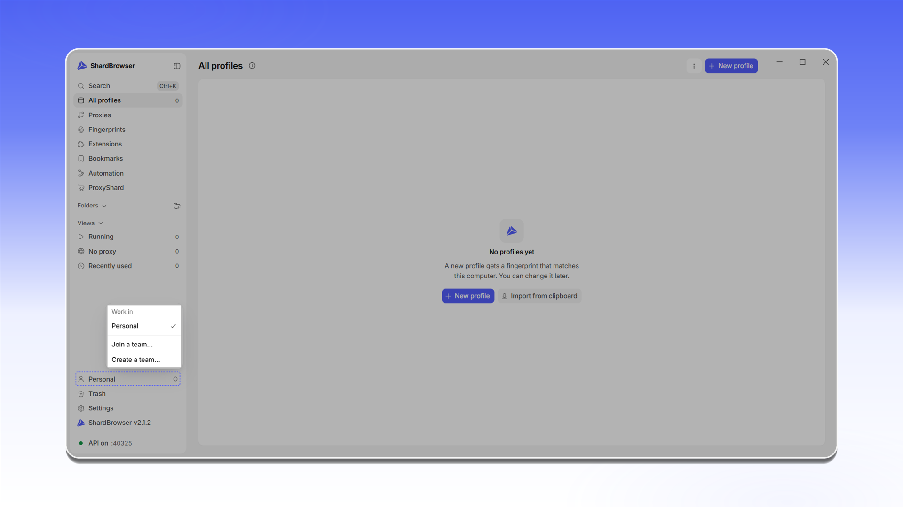
  </picture>
  <figcaption>Workspace menu - “Create a team...”</figcaption>
</figure>

The <mark style="color:purple;">**Create a team**</mark> window opens. Enter the team name in the <mark style="color:purple;">**Team name**</mark> field. The server reads it only on the first start; you can rename the team later on its page.

<figure>
  <picture>
    <source srcset="../../.gitbook/assets/shardbrowser-team-create-dialog_black.png" media="(prefers-color-scheme: dark)">
    
  </picture>
  <figcaption>Create a team window - enter the team name</figcaption>
</figure>

Keep this window open: you will need the server start command and the connection fields later.

---

## Installing Docker and the team server on a VPS

Connect to the server over SSH and install Docker with the official script:

```bash
curl -fsSL https://get.docker.com -o get-docker.sh
sudo sh get-docker.sh
```

The script adds the Docker repository, installs the packages and starts the service. At the end it prints the Docker Engine client and server versions.

<figure>
  <picture>
    <source srcset="../../.gitbook/assets/shardbrowser-team-vps-docker-install_black.png" media="(prefers-color-scheme: dark)">
    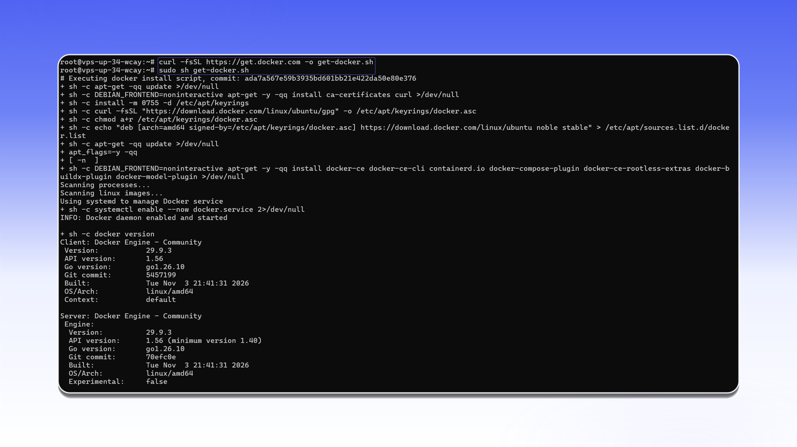
  </picture>
  <figcaption>Installing Docker with get-docker.sh</figcaption>
</figure>

If a message about rootless mode and Docker API access appears at the end, it is just the installer's standard note. Nothing extra needs to be set up for the team server.

<figure>
  <picture>
    <source srcset="../../.gitbook/assets/shardbrowser-team-vps-docker-install-done_black.png" media="(prefers-color-scheme: dark)">
    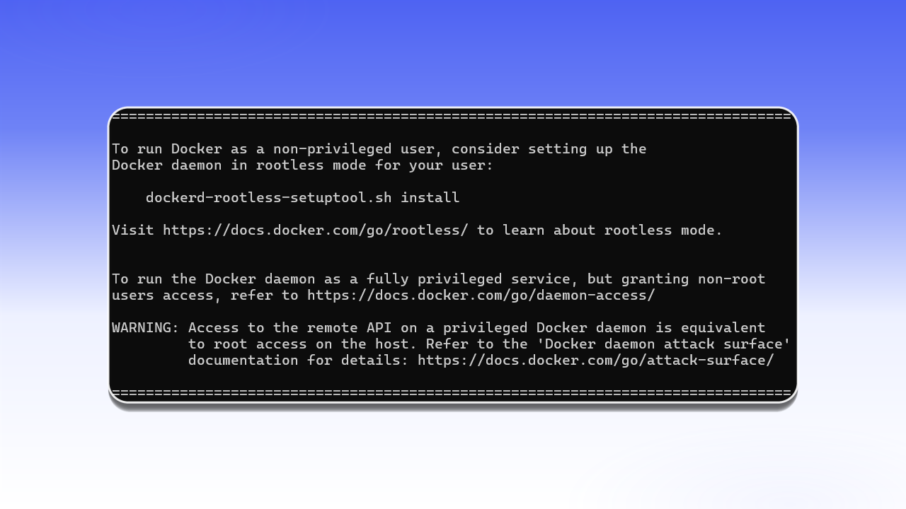
  </picture>
  <figcaption>Docker installer note at the end of installation</figcaption>
</figure>

Go back to ShardBrowser. On the <mark style="color:purple;">**Docker**</mark> tab of the <mark style="color:purple;">**Create a team**</mark> window, the server start command with your team name is ready. Copy it with the button to the right of the field.

<figure>
  <picture>
    <source srcset="../../.gitbook/assets/shardbrowser-team-create-docker-command_black.png" media="(prefers-color-scheme: dark)">
    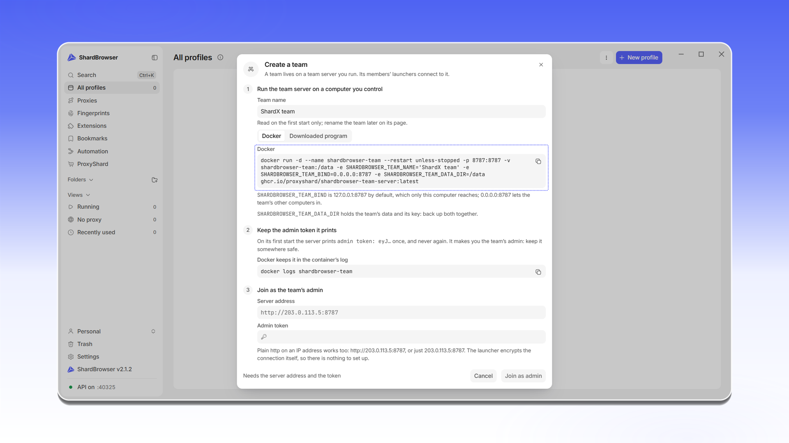
  </picture>
  <figcaption>Copy the start command on the Docker tab</figcaption>
</figure>


`SHARDBROWSER_TEAM_BIND` defaults to `127.0.0.1:8787`, which means the server can only be reached from the same machine. To let other members connect, keep `0.0.0.0:8787` in the command.

`SHARDBROWSER_TEAM_DATA_DIR` is the folder with the team's data and its key. Back up the whole folder together.


On the server, enable Docker autostart, check the installation and run the copied command:

```bash
sudo systemctl enable docker
sudo systemctl start docker
sudo usermod -aG docker $USER
docker --version
docker compose version
```

```bash
docker run -d --name shardbrowser-team --restart unless-stopped -p 8787:8787 -v shardbrowser-team:/data -e SHARDBROWSER_TEAM_NAME='ShardX team' -e SHARDBROWSER_TEAM_BIND=0.0.0.0:8787 -e SHARDBROWSER_TEAM_DATA_DIR=/data ghcr.io/proxyshard/shardbrowser-team-server:latest
```

Instead of `ShardX team`, the command will contain the name you entered. Docker pulls the `shardbrowser-team-server` image and starts the `shardbrowser-team` container. Thanks to `--restart unless-stopped`, the server comes back up by itself after the VPS reboots.

<figure>
  <picture>
    <source srcset="../../.gitbook/assets/shardbrowser-team-vps-server-run_black.png" media="(prefers-color-scheme: dark)">
    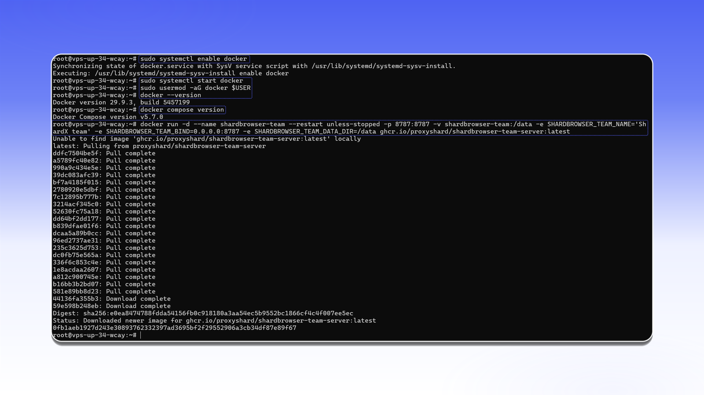
  </picture>
  <figcaption>Starting the team server container</figcaption>
</figure>

On its first start, the server prints the admin token to the log once. View it with:

```bash
docker logs shardbrowser-team
```

Copy the <mark style="color:purple;">`admin token`</mark> value. The log also contains an <mark style="color:purple;">`invite`</mark> (a link with the same token; replace `0.0.0.0` with the server address) and the <mark style="color:purple;">`public key`</mark> that launchers use to verify the server.

<figure>
  <picture>
    <source srcset="../../.gitbook/assets/shardbrowser-team-vps-admin-token_black.png" media="(prefers-color-scheme: dark)">
    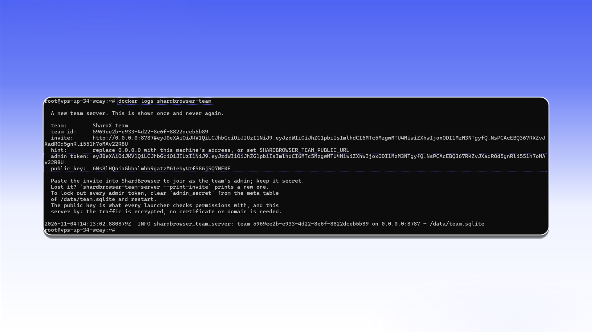
  </picture>
  <figcaption>Admin token in the container log</figcaption>
</figure>


The admin token is shown only on the first start and gives full access to the team. Keep it somewhere safe and never share it. If the token is lost, the `shardbrowser-team-server --print-invite` command prints a new one.


---

## Joining the team as admin

In the <mark style="color:purple;">**Create a team**</mark> window, in the <mark style="color:purple;">**Join as the team's admin**</mark> block, fill in the fields:

* <mark style="color:purple;">**Server address**</mark> - the server's IP address and port, for example `203.0.113.5:8787` or `http://203.0.113.5:8787`. No domain or certificate is needed: the launcher encrypts the connection itself.
* <mark style="color:purple;">**Admin token**</mark> - the token from the container log.

Click <mark style="color:purple;">**Join as admin**</mark>.

<figure>
  <picture>
    <source srcset="../../.gitbook/assets/shardbrowser-team-join-as-admin_black.png" media="(prefers-color-scheme: dark)">
    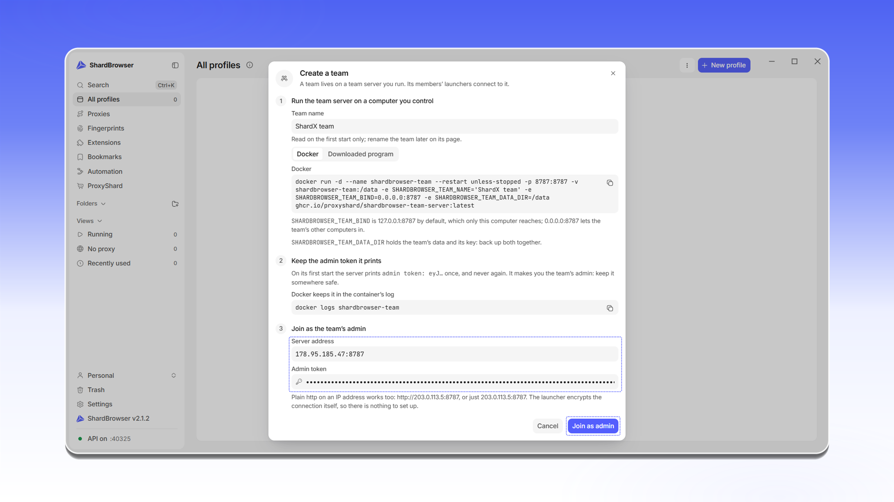
  </picture>
  <figcaption>Enter the server address and admin token</figcaption>
</figure>

The team page opens. Your team is now selected in the switcher at the bottom left. Profiles created in this mode are stored on the team server. The <mark style="color:purple;">**Getting the team going**</mark> block shows the order of steps: create folders, create profiles, add members and give them rights.

<figure>
  <picture>
    <source srcset="../../.gitbook/assets/shardbrowser-team-page-empty_black.png" media="(prefers-color-scheme: dark)">
    
  </picture>
  <figcaption>New team page</figcaption>
</figure>

---

## Adding a member

Click <mark style="color:purple;">**+ Add member**</mark>.

<figure>
  <picture>
    <source srcset="../../.gitbook/assets/shardbrowser-team-add-member-button_black.png" media="(prefers-color-scheme: dark)">
    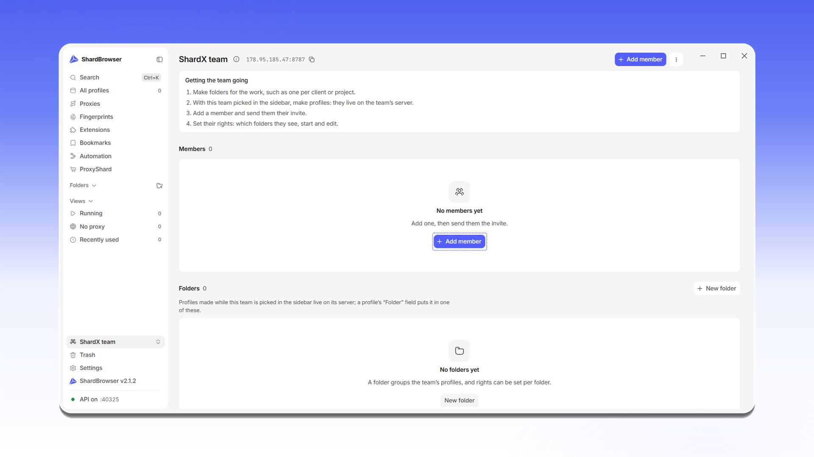
  </picture>
  <figcaption>Add member button</figcaption>
</figure>

Enter the member's name and click <mark style="color:purple;">**Add member**</mark>.

<figure>
  <picture>
    <source srcset="../../.gitbook/assets/shardbrowser-team-add-member-dialog_black.png" media="(prefers-color-scheme: dark)">
    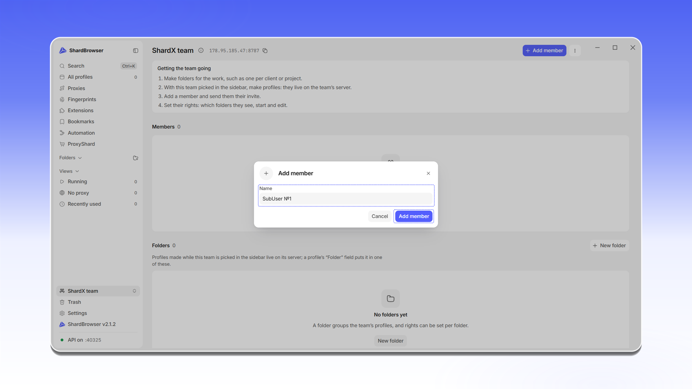
  </picture>
  <figcaption>New member's name</figcaption>
</figure>

An invite for the member appears. Copy it and send it to the member: they will paste it in the <mark style="color:purple;">**Join a team**</mark> window. The invite is shown only once; you can create a new one with <mark style="color:purple;">**New invite...**</mark> in the member's menu.

Until the member has rights, the team is empty for them. Click <mark style="color:purple;">**Set rights...**</mark> to give access right away.

<figure>
  <picture>
    <source srcset="../../.gitbook/assets/shardbrowser-team-member-invite_black.png" media="(prefers-color-scheme: dark)">
    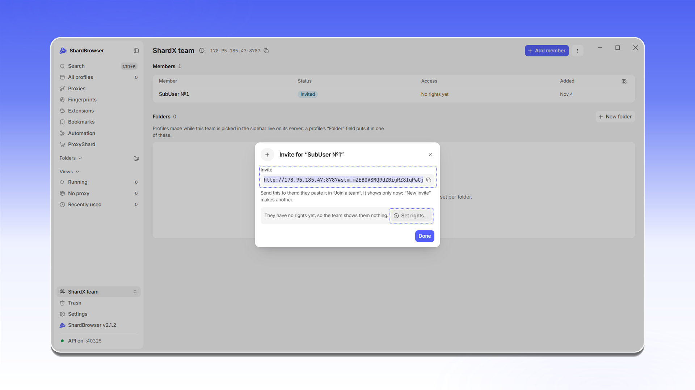
  </picture>
  <figcaption>Member invite and the Set rights button</figcaption>
</figure>

---

## Member rights

In the <mark style="color:purple;">**Rights**</mark> window, rights are set in a table. Click a cell (or press `Space`) to switch it between not set, allowed (check mark) and refused (cross). When rules overlap, the narrowest one wins.

| Right        | What it allows                       |
| ------------ | ------------------------------------ |
| **See**      | See profiles                         |
| **Start**    | Start profiles                       |
| **Edit**     | Edit profiles                        |
| **Create**   | Create profiles                      |
| **Delete**   | Delete profiles                      |
| **Cookies**  | Work with profile cookies            |
| **Take out** | Take profiles out of the team        |

For quick setup of the <mark style="color:purple;">**Whole team**</mark> row there are presets: <mark style="color:purple;">**None**</mark>, <mark style="color:purple;">**See only**</mark>, <mark style="color:purple;">**Start**</mark>, <mark style="color:purple;">**Edit**</mark> and <mark style="color:purple;">**All but take out**</mark>. Rights can also be set separately for each team folder. Click <mark style="color:purple;">**Save rights**</mark>.

<figure>
  <picture>
    <source srcset="../../.gitbook/assets/shardbrowser-team-member-rights_black.png" media="(prefers-color-scheme: dark)">
    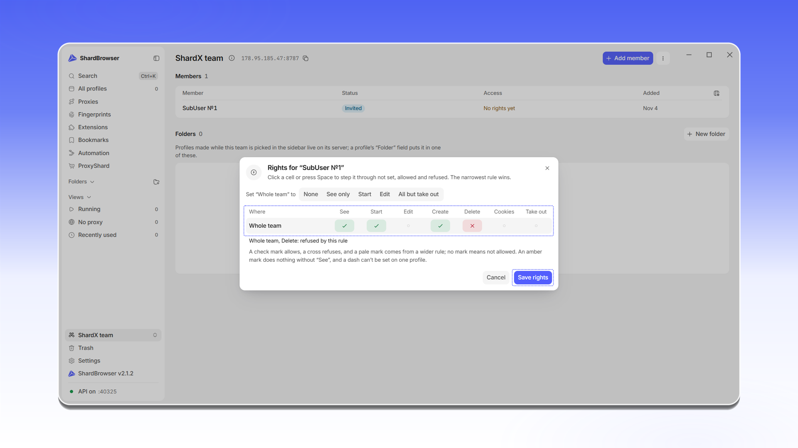
  </picture>
  <figcaption>Member rights for the whole team</figcaption>
</figure>


A right without <mark style="color:purple;">**See**</mark> does nothing: a member can't start or edit a profile they can't see.


Granted rights are shown in the <mark style="color:purple;">**Access**</mark> column. In the member's menu (<mark style="color:purple;">**⋮**</mark>) you can change rights (<mark style="color:purple;">**Rights...**</mark>), temporarily disable the member (<mark style="color:purple;">**Switch off**</mark>), create a new invite (<mark style="color:purple;">**New invite...**</mark>) or remove the member from the team (<mark style="color:purple;">**Remove...**</mark>).

<figure>
  <picture>
    <source srcset="../../.gitbook/assets/shardbrowser-team-member-menu_black.png" media="(prefers-color-scheme: dark)">
    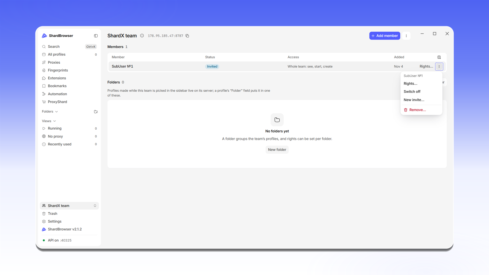
  </picture>
  <figcaption>Member menu</figcaption>
</figure>

---

## Team folders and profiles

Team folders are created with the <mark style="color:purple;">**+ New folder**</mark> button on the team page and appear in the side menu like regular folders. A new profile goes into the folder set in its <mark style="color:purple;">**Folder**</mark> field.

The workspace switcher at the bottom left shows where you are working now: in <mark style="color:purple;">**Personal**</mark> (local profiles) or in a team, shown with its server address. From this menu the admin opens the team page (<mark style="color:purple;">**Manage team**</mark>), and can also join another team, create a new one or leave the current one (<mark style="color:purple;">**Leave this team...**</mark>).

<figure>
  <picture>
    <source srcset="../../.gitbook/assets/shardbrowser-team-manage-team-menu_black.png" media="(prefers-color-scheme: dark)">
    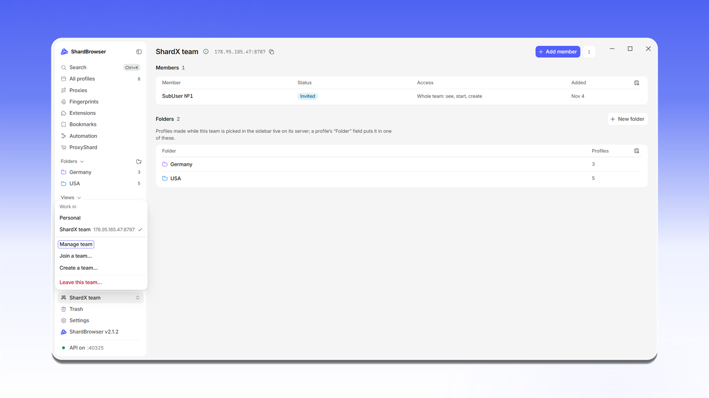
  </picture>
  <figcaption>Team folders and the Manage team menu</figcaption>
</figure>

---

## Joining a team as a member

The member opens ShardBrowser, clicks the <mark style="color:purple;">**Personal**</mark> switcher and selects <mark style="color:purple;">**Join a team...**</mark>.

<figure>
  <picture>
    <source srcset="../../.gitbook/assets/shardbrowser-team-join-menu_black.png" media="(prefers-color-scheme: dark)">
    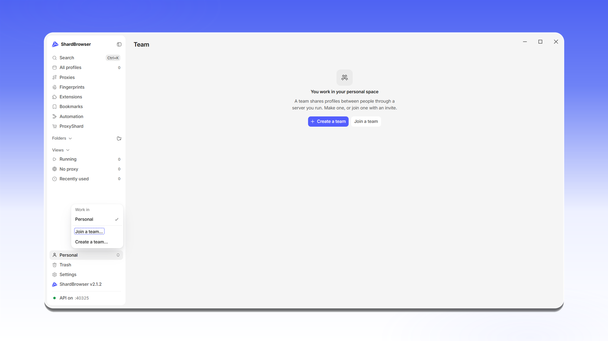
  </picture>
  <figcaption>Workspace menu - “Join a team...”</figcaption>
</figure>

In the <mark style="color:purple;">**Join a team**</mark> window, paste the invite received from the admin into the <mark style="color:purple;">**Invite or server address**</mark> field. The server address and <mark style="color:purple;">**Access token**</mark> are filled in automatically. Then click <mark style="color:purple;">**Join**</mark>.

<figure>
  <picture>
    <source srcset="../../.gitbook/assets/shardbrowser-team-join-dialog_black.png" media="(prefers-color-scheme: dark)">
    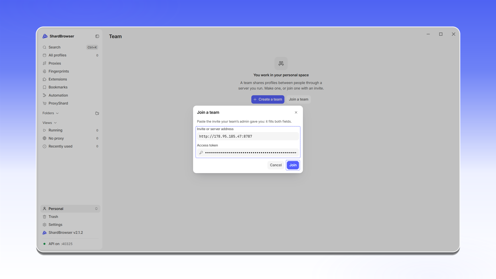
  </picture>
  <figcaption>Paste the invite in the Join a team window</figcaption>
</figure>

After joining, the member's switcher menu gets a <mark style="color:purple;">**Your access**</mark> item. It shows the rights the admin has given. Only the admin can change them.

<figure>
  <picture>
    <source srcset="../../.gitbook/assets/shardbrowser-team-your-access_black.png" media="(prefers-color-scheme: dark)">
    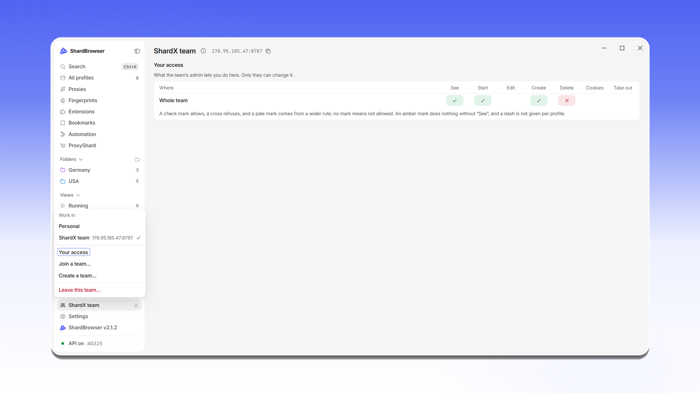
  </picture>
  <figcaption>Member rights in Your access</figcaption>
</figure>

In <mark style="color:purple;">**All profiles**</mark>, the member sees the team's profiles from the folders available to them and works with them within the granted rights. To return to local profiles, select <mark style="color:purple;">**Personal**</mark> in the switcher.

<figure>
  <picture>
    <source srcset="../../.gitbook/assets/shardbrowser-team-profiles_black.png" media="(prefers-color-scheme: dark)">
    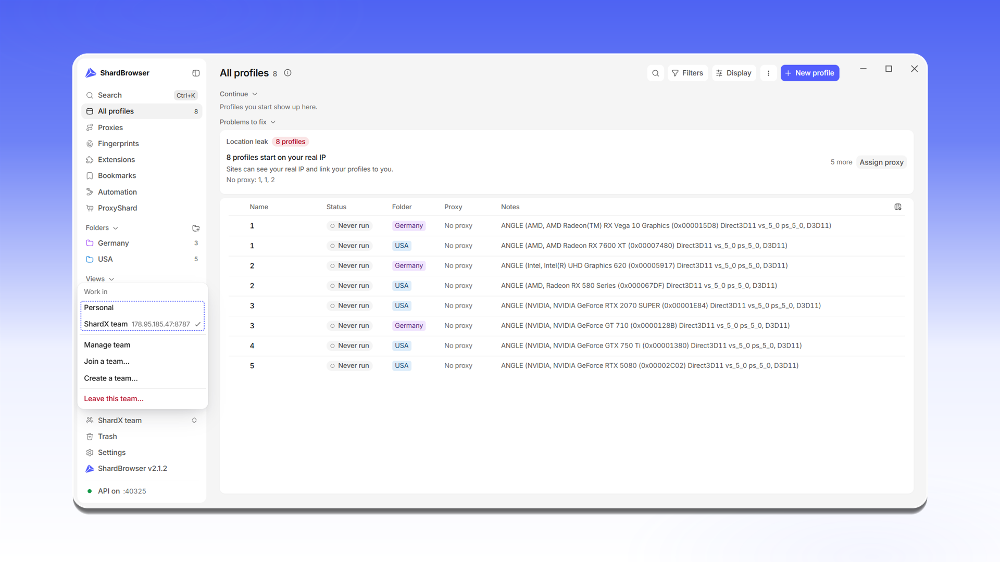
  </picture>
  <figcaption>Team profiles on the member's side</figcaption>
</figure>
