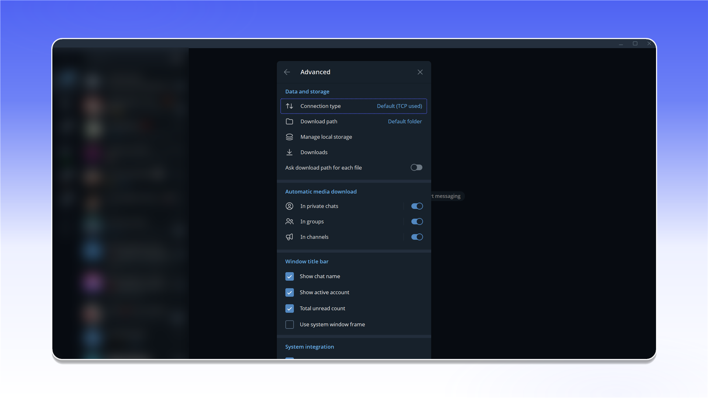
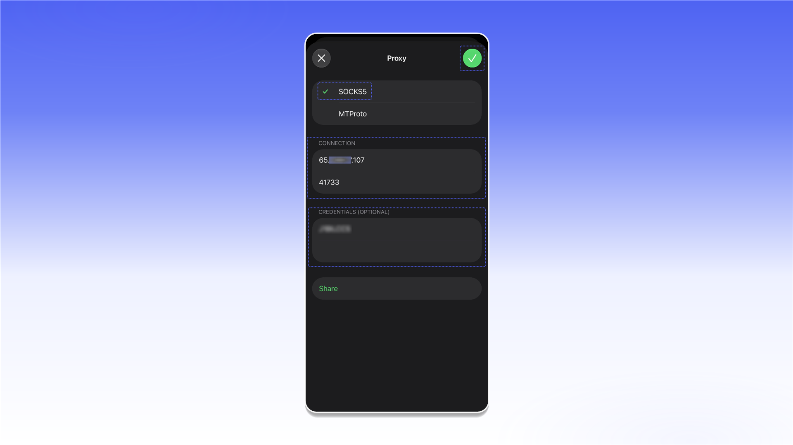

# Telegram

## Telegram Desktop

Open `Settings`.

<figure>
  <picture>
    <source srcset="../.gitbook/assets/telegram-desktop-menu-settings_black.png" media="(prefers-color-scheme: dark)">
    
  </picture>
</figure>

Open `Advanced`.

<figure>
  <picture>
    <source srcset="../.gitbook/assets/telegram-desktop-settings-advanced_black.png" media="(prefers-color-scheme: dark)">
    
  </picture>
</figure>

Under `Network and proxy`, open `Connection type`.

<figure>
  <picture>
    <source srcset="../.gitbook/assets/telegram-desktop-connection-type_black.png" media="(prefers-color-scheme: dark)">
    
  </picture>
</figure>

Select `Use custom proxy`, click `Add proxy`, and choose a protocol. Fill in the address, port, username, and password using the details from your order's `Proxy List`.


The data format and an example order are described in [Getting Started](getting-started.md).


<figure>
  <picture>
    <source srcset="../.gitbook/assets/telegram-desktop-use-custom-proxy_black.png" media="(prefers-color-scheme: dark)">
    
  </picture>
</figure>

Save the settings and confirm that the proxy status is `Connected`.

<figure>
  <picture>
    <source srcset="../.gitbook/assets/telegram-desktop-proxy-connected_black.png" media="(prefers-color-scheme: dark)">
    
  </picture>
</figure>

## Telegram for iOS

Open `Settings` and select `Data and Storage`.

<figure>
  <picture>
    <source srcset="../.gitbook/assets/telegram-ios-settings-data-storage_black.png" media="(prefers-color-scheme: dark)">
    
  </picture>
</figure>

Open `Proxy`, then tap `Add Proxy`.

<figure>
  <picture>
    <source srcset="../.gitbook/assets/telegram-ios-connection-proxy_black.png" media="(prefers-color-scheme: dark)">
    
  </picture>
</figure>

Select `SOCKS5` and fill in `Server`, `Port`, `Username`, and `Password` using the details from your order's `Proxy List`.

<figure>
  <picture>
    <source srcset="../.gitbook/assets/telegram-ios-proxy-socks5-form_black.png" media="(prefers-color-scheme: dark)">
    
  </picture>
</figure>

Save the settings and enable the proxy you created.
