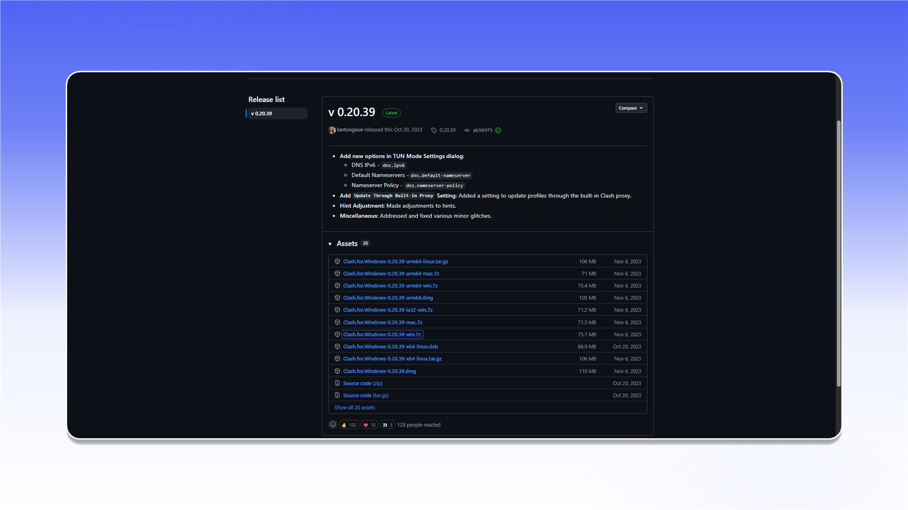
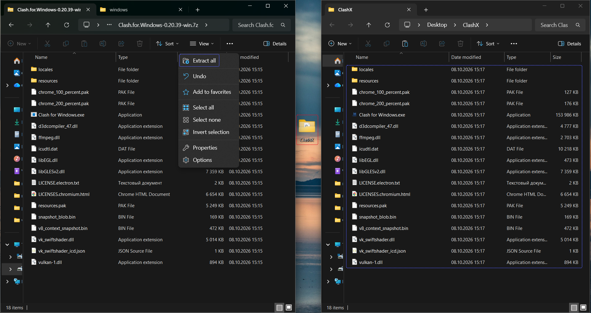
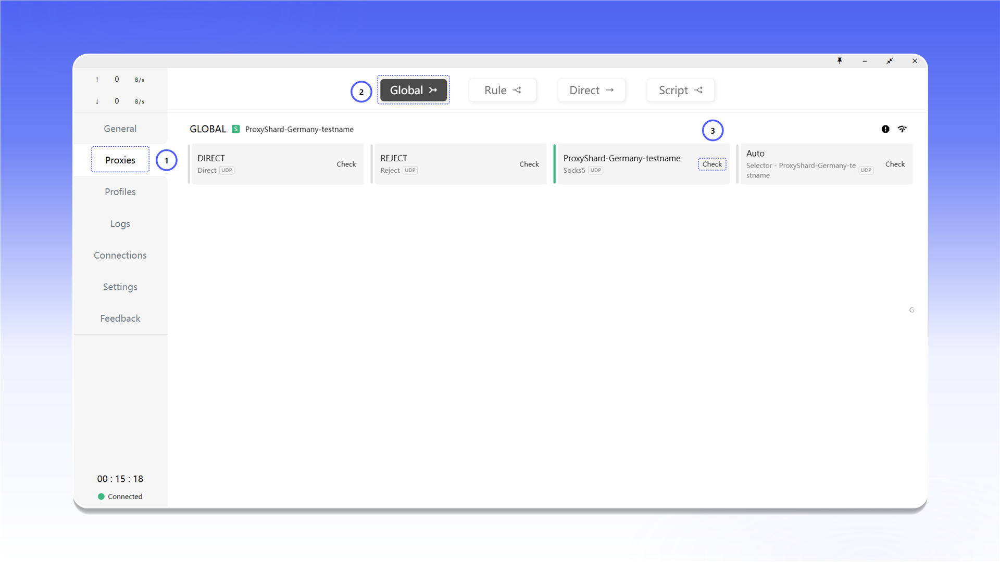
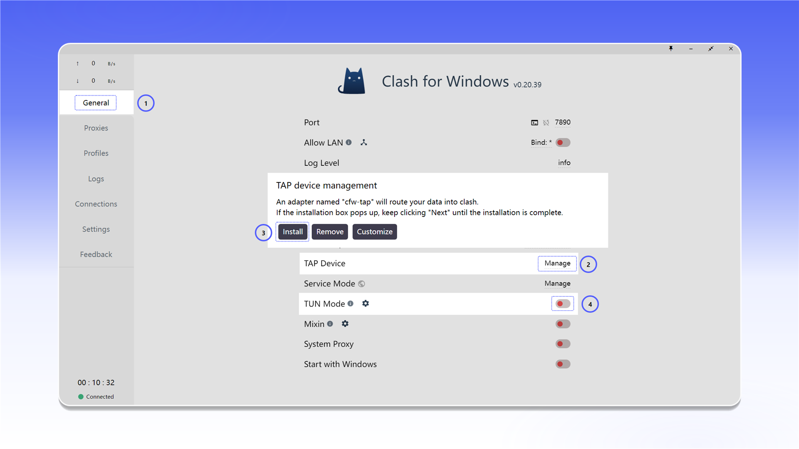

# Clash for Windows


Clash for Windows can proxy both TCP and UDP traffic in TUN mode.


## Download and launch

Open the [Clash for Windows releases page](https://github.com/lantongxue/clash_for_windows_pkg/releases) and download `Clash.for.Windows-0.20.39-win.7z`.

<figure>
  <picture>
    <source srcset="../../.gitbook/assets/clashx-github-download_black.png" media="(prefers-color-scheme: dark)">
    
  </picture>
</figure>

Extract the archive to a separate folder.

<figure><figcaption></figcaption></figure>

Run `Clash for Windows.exe` as administrator. Administrator access is required to install and operate the system network driver.

<figure><figcaption></figcaption></figure>

## Configure the profile

1. Open `Profiles`.
2. Click the `<>` icon next to `config.yaml`.

<figure>
  <picture>
    <source srcset="../../.gitbook/assets/clashx-profiles-edit-config_black.png" media="(prefers-color-scheme: dark)">
    
  </picture>
</figure>

Add the proxy under `proxies:` and enter the details from your order. This example uses SOCKS5.

```yaml
proxies:
  - name: "ShardX-Germany"
    type: socks5
    server: 123.123.123.123
    port: 41733
    username: proxy_login
    password: proxy_password
    udp: true

proxy-groups:
  - name: "ShardX"
    type: select
    proxies:
      - ShardX-Germany

rules:
  - PROCESS-NAME,chrome.exe,ShardX
  - MATCH,DIRECT
```

`name` is the connection name. Enter the proxy details in `server`, `port`, `username`, and `password`. The `udp: true` setting enables UDP for this server.

<figure>
  <picture>
    <source srcset="../../.gitbook/assets/clashx-profile-config-proxies_black.png" media="(prefers-color-scheme: dark)">
    
  </picture>
</figure>


See the [general setup guide](../getting-started.md) for help finding the connection details.


## Activate and test the proxy

1. Open `Proxies`.
2. Select `Global` mode.
3. Click `Check` next to the ShardX server.

<figure>
  <picture>
    <source srcset="../../.gitbook/assets/clashx-proxies-global-select_black.png" media="(prefers-color-scheme: dark)">
    
  </picture>
</figure>

If the connection is available, the server card will show its latency.

<figure><figcaption></figcaption></figure>

## Add multiple proxies

Add each server as a separate item under `proxies:` and list their names in the `ShardX` group. After saving the configuration, the servers will appear under `Proxies`, where you can switch between them.

<figure>
  <picture>
    <source srcset="../../.gitbook/assets/clashx-proxies-multiple-list_black.png" media="(prefers-color-scheme: dark)">
    
  </picture>
</figure>

## Enable TUN Mode

1. Open `General`.
2. In the `TAP Device` row, click `Manage`, then `Install`.
3. Enable `TUN Mode` to route system traffic through the selected proxy.

<figure>
  <picture>
    <source srcset="../../.gitbook/assets/clashx-general-tap-tun-setup_black.png" media="(prefers-color-scheme: dark)">
    
  </picture>
</figure>

## Verify the connection

Open [ShardX IP Checker](https://proxyshard.com/tools/ip-checker) and confirm that it displays the proxy IP address.

<figure>
  <picture>
    <source srcset="../../.gitbook/assets/clashx-ip-checker-result_black.png" media="(prefers-color-scheme: dark)">
    
  </picture>
</figure>

You can also check for WebRTC leaks with BrowserLeaks.

<figure>
  <picture>
    <source srcset="../../.gitbook/assets/clashx-browserleaks-check_black.png" media="(prefers-color-scheme: dark)">
    
  </picture>
</figure>

If the connection does not work, verify the values in `config.yaml`, restart the application as administrator, and follow the [troubleshooting guide](../../faq-and-support/faq/proxy-not-working.md).
