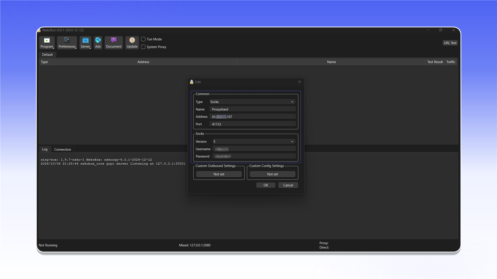
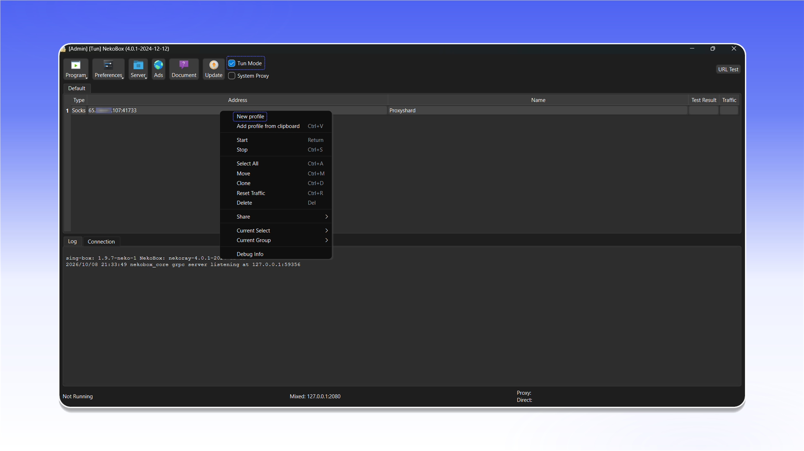

# NekoRay


NekoRay can proxy both TCP and UDP traffic in TUN mode.


## Download and launch

Download the Windows archive from the [NekoRay releases page](https://github.com/MatsuriDayo/nekoray/releases), extract it, and run `nekoray.exe` or `nekobox.exe`. Select the `sing-box` core on first launch.

<figure>
  <picture>
    <source srcset="../../.gitbook/assets/nekoray-github-download_black.png" media="(prefers-color-scheme: dark)">
    
  </picture>
</figure>

## Create a profile

Right-click an empty area in the server list and select `New profile`.

<figure>
  <picture>
    <source srcset="../../.gitbook/assets/nekoray-main-new-profile_black.png" media="(prefers-color-scheme: dark)">
    
  </picture>
</figure>

Select `Socks` from the `Type` list.

<figure>
  <picture>
    <source srcset="../../.gitbook/assets/nekoray-profile-type-socks_black.png" media="(prefers-color-scheme: dark)">
    
  </picture>
</figure>

Enter the connection details:

1. Enter any recognizable name in `Name`.
2. Enter the proxy address and port in `Address` and `Port`.
3. Under `Socks`, select `Version: 5`.
4. Enter the `Username` and `Password`.
5. Click `OK`.

<figure>
  <picture>
    <source srcset="../../.gitbook/assets/nekoray-profile-config_black.png" media="(prefers-color-scheme: dark)">
    
  </picture>
</figure>


See the [general setup guide](../getting-started.md) for help finding the connection details.


## Connect

Select the created profile and enable `Tun Mode` in the top bar. Once connected, system traffic will be routed through the configured proxy.

<figure>
  <picture>
    <source srcset="../../.gitbook/assets/nekoray-tun-mode-enable_black.png" media="(prefers-color-scheme: dark)">
    
  </picture>
</figure>
