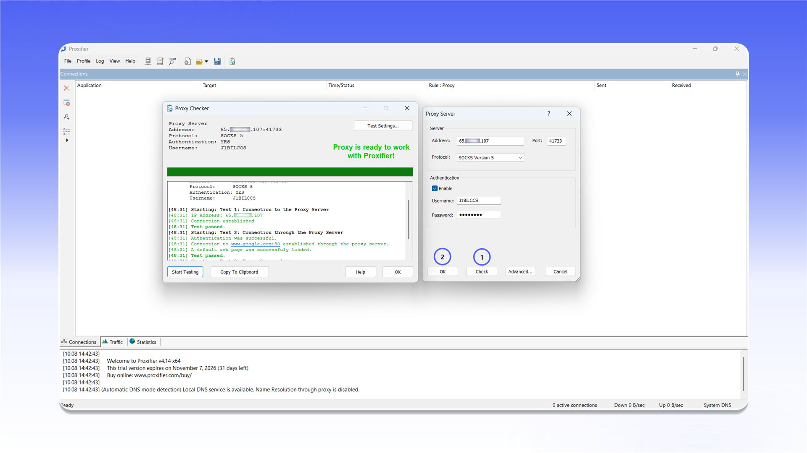
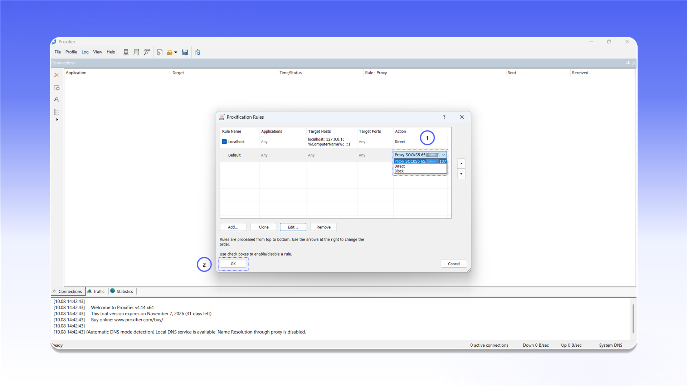

# Proxifier


Proxifier does not support UDP proxying.



Proxifier is paid software with a 31-day trial.


## Installation

Open the [Proxifier download page](https://www.proxifier.com/download/), download `ProxifierSetup.exe`, and install the application.

<figure>
  <picture>
    <source srcset="../../.gitbook/assets/proxifier-website-download_black.png" media="(prefers-color-scheme: dark)">
    
  </picture>
</figure>

## Add a proxy

1. Launch Proxifier.
2. Open `Profile` and select `Proxy Servers...`.

<figure>
  <picture>
    <source srcset="../../.gitbook/assets/proxifier-menu-proxy-servers_black.png" media="(prefers-color-scheme: dark)">
    
  </picture>
</figure>

Click `Add...` in the `Proxy Servers` window and complete the form:

- `Address`: the proxy IP address or hostname;
- `Port`: the connection port;
- `Protocol`: `SOCKS Version 5`, or `HTTPS` for an HTTP proxy;
- `Authentication`: enable `Enable`, then enter the `Username` and `Password`.

<figure>
  <picture>
    <source srcset="../../.gitbook/assets/proxifier-add-proxy-dialog_black.png" media="(prefers-color-scheme: dark)">
    
  </picture>
</figure>


See the [general setup guide](../getting-started.md) for help finding the connection details.


Click `Check`. After `Proxy is ready to work with Proxifier!` appears, close the test window with `OK` and save the server.

<figure>
  <picture>
    <source srcset="../../.gitbook/assets/proxifier-proxy-check-success_black.png" media="(prefers-color-scheme: dark)">
    
  </picture>
</figure>

## Configure routing

Open `Profile` and select `Proxification Rules...`.

<figure>
  <picture>
    <source srcset="../../.gitbook/assets/proxifier-menu-proxification-rules_black.png" media="(prefers-color-scheme: dark)">
    
  </picture>
</figure>

In the `Default` row, open the list under `Action`, select the added SOCKS5 proxy, and click `OK`. Application traffic will now use the selected server.

<figure>
  <picture>
    <source srcset="../../.gitbook/assets/proxifier-rules-configuration_black.png" media="(prefers-color-scheme: dark)">
    
  </picture>
</figure>
