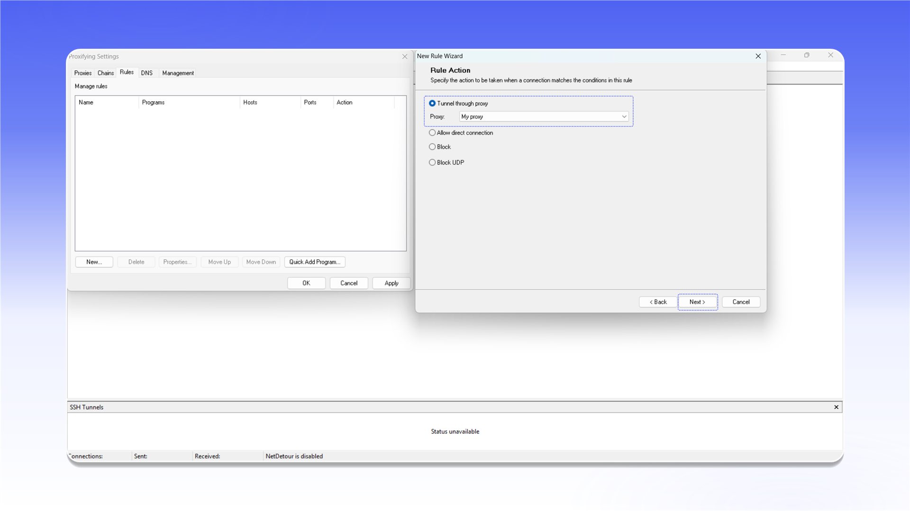

# ProxyCap (NetDetour)


NetDetour supports both TCP and UDP proxying.



NetDetour is the current successor to ProxyCap. It is paid software with a 30-day trial.


## Installation

Open the [download page](https://www.proxycap.com/download.html), click `Download NetDetour`, and install the application.

<figure>
  <picture>
    <source srcset="../../.gitbook/assets/proxycap-netdetour-website-download_black.png" media="(prefers-color-scheme: dark)">
    
  </picture>
</figure>

## Add a proxy

1. Click the `Proxifying Settings` icon in the top bar.
2. Open the `Proxies` tab.
3. Select `SOCKS5` and click `Add...`.

<figure>
  <picture>
    <source srcset="../../.gitbook/assets/proxycap-netdetour-settings-add-proxy_black.png" media="(prefers-color-scheme: dark)">
    
  </picture>
</figure>

Complete the `New SOCKS5 Proxy Server` form:

- `Name`: any recognizable name;
- `Host`: the proxy IP address or hostname;
- `Port`: the connection port;
- `Proxy requires authentication`: enable this option;
- `Use Username/Password authentication`: enter the username and password.

Click `OK` to save the server.

<figure>
  <picture>
    <source srcset="../../.gitbook/assets/proxycap-netdetour-proxy-server-config_black.png" media="(prefers-color-scheme: dark)">
    
  </picture>
</figure>


See the [general setup guide](../getting-started.md) for help finding the connection details.


## Create a rule

1. Open the `Rules` tab in `Proxifying Settings`.
2. Click `New...`.
3. Under `Rule Action`, select `Tunnel through proxy`.
4. Select the connection from the `Proxy` list.
5. Click `Next >`, choose the required applications or keep the rule active for all applications, then save it.

<figure>
  <picture>
    <source srcset="../../.gitbook/assets/proxycap-netdetour-rule-action-wizard_black.png" media="(prefers-color-scheme: dark)">
    
  </picture>
</figure>
