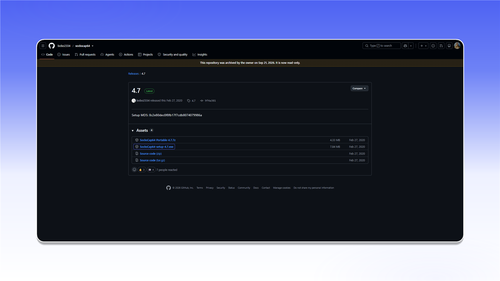

# SocksCap64


SocksCap64 supports both TCP and UDP proxying.


## Installation

Download `SocksCap64-setup-4.7.exe` from the [release page](https://github.com/bobo2334/sockscap64/releases/tag/4.7), install it, and run SocksCap64 as administrator.

<figure>
  <picture>
    <source srcset="../../.gitbook/assets/sockscap64-github-download_black.png" media="(prefers-color-scheme: dark)">
    
  </picture>
</figure>

## Add a proxy

1. Click `Proxy` in the top bar.
2. In `Proxy Manager`, click `+`.
3. Enter the connection details:
   - `Proxy Address`: the server IP address or hostname;
   - `Port`: the connection port;
   - `Account`: the username;
   - `Password`: the password;
   - `SOCKS Type`: `SOCKS 5`.
4. Click `Save`.

<figure>
  <picture>
    <source srcset="../../.gitbook/assets/sockscap64-proxy-manager-config_black.png" media="(prefers-color-scheme: dark)">
    
  </picture>
</figure>


See the [general setup guide](../getting-started.md) for help finding the connection details.


## Add an application

Click `Apps`, select the required application in `Programs selector`, and click `OK`.

<figure>
  <picture>
    <source srcset="../../.gitbook/assets/sockscap64-programs-selector-add_black.png" media="(prefers-color-scheme: dark)">
    
  </picture>
</figure>

## Run through the proxy

Right-click the added application and select `Run selected program in tunnel`. The application will start through the configured SOCKS5 proxy.

<figure>
  <picture>
    <source srcset="../../.gitbook/assets/sockscap64-run-program-in-tunnel_black.png" media="(prefers-color-scheme: dark)">
    
  </picture>
</figure>
