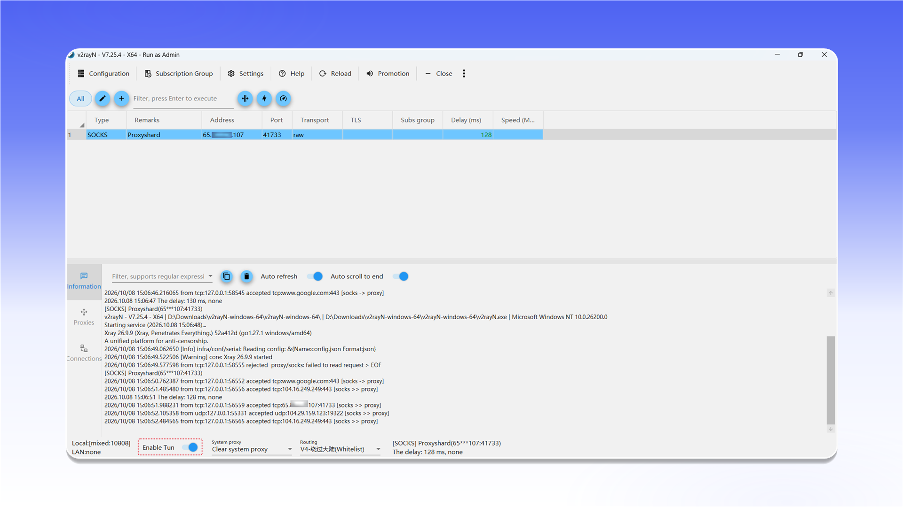

# v2rayN


v2rayN can proxy both TCP and UDP traffic in TUN mode.


## Download and launch

Open the [latest v2rayN release](https://github.com/2dust/v2rayN/releases/latest), download `v2rayN-windows-64.zip`, extract it, and run `v2rayN.exe` as administrator.

<figure>
  <picture>
    <source srcset="../../.gitbook/assets/v2rayn-github-download_black.png" media="(prefers-color-scheme: dark)">
    
  </picture>
</figure>

## Add a SOCKS server

Open `Configuration` and select `Add [SOCKS]`.

<figure>
  <picture>
    <source srcset="../../.gitbook/assets/v2rayn-menu-add-socks_black.png" media="(prefers-color-scheme: dark)">
    
  </picture>
</figure>

Enter the connection details:

- `Alias (remarks)`: any recognizable name;
- `Address`: the proxy IP address or hostname;
- `Port`: the connection port;
- `User(Optional)`: the username;
- `Password(Optional)`: the password.

Click `Confirm` to save the profile.

<figure>
  <picture>
    <source srcset="../../.gitbook/assets/v2rayn-socks-config-dialog_black.png" media="(prefers-color-scheme: dark)">
    
  </picture>
</figure>


See the [general setup guide](../getting-started.md) for help finding the connection details.


## Connect

Select the created server and test its latency. Then enable `Enable Tun` in the bottom bar to route system traffic through the proxy.

<figure>
  <picture>
    <source srcset="../../.gitbook/assets/v2rayn-enable-tun-mode_black.png" media="(prefers-color-scheme: dark)">
    
  </picture>
</figure>
